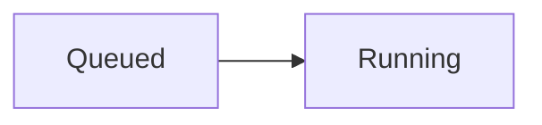

# Design toolkit

[Asset rules and adoption](asset-rules.md) · [Agent CLI interface](agent-interface.md) · [ADG design](design.md) · [Architecture](architecture.md) · [Performance](performance.md)

A project's `design/` directory holds TSX sources that define how its UI looks. The implementation follows them. The `adg` toolkit builds the sources into static frames, checks them, renders them for review, compares them with the running implementation, and presents the library as boards in the viewer (`adg <directory>`), with comments. `adg review` generates a standalone visual comparison.

This document is the source format and authoring command contract. The [agent CLI interface](agent-interface.md) defines `--json` output, command data schemas, exit codes and recovery actions. The [design asset rules](asset-rules.md) define layers, ownership, states, frame naming, fidelity and lifecycle, with an adoption guide for existing projects. A project's own mapping and governance documents keep its direction, declared forms, implementation locations, approval process and concrete gaps.

## Install

`adg` is installed once per machine and shared by every project. Projects do not list it in their dependencies.

```sh
npm install -g @whzxc/agent-design-gallery
```

The package comes from the public npm registry. Run the same install again to update. `check`, `render`, `compare` and `diff` use Chromium through the Playwright that ships with `adg`; the viewer and TSX builds start without it. Standalone `impact` does not launch a browser; selective zero-job commands can also finish without one. When Chromium is missing, those commands stop with the command that installs it for that Playwright version.

A project may set `requires` in `adg.config.mjs`, such as `'>=0.4.0'`. Older versions stop with exit code 2 and the update command, so every contributor checks with the same rules.

## One-time name migration

```sh
adg migrate /path/to/project
adg service migrate
```

`adg migrate [project]` renames `sdg.config.mjs`, `.js` and `.ts`, rewrites `sdg`, `sdg/jsx-runtime`,
`sdg/jsx-dev-runtime` and `sdg:self` imports under the configured design directory, updates editor paths and
`.sdg/` ignore entries in the project's `.gitignore` files, removes the old generated directory and regenerates
`.adg/`. Each change is printed. Repeating the command is safe; mixed old/new config names are refused before
any edits. Commands encountering only an old current-project config require this migration. `diff` migrates a legacy base only in its disposable historical tree and records that migration.

`adg service migrate` moves the entire old hub state directory and replaces its macOS LaunchAgent with the current
Node/CLI paths and previous port. `--state-dir` sets the destination; an existing destination or new LaunchAgent
is refused. The key prefix is updated without printing the key. Afterwards it lists other LaunchAgents referencing
the old path for the operator to update. See [local updates](local-updates.md#one-time-service-migration) for paths
and service migration details.

## Project layout

- `adg.config.mjs`, `adg.config.js` or `adg.config.ts` at the project root configures paths, `sources`, `check` and `compare`. Every field is optional.
- `design/tokens.css` holds color, type, radius, size and shadow tokens for the light and dark themes.
- `design/components/<name>.tsx` holds one building block that more than one feature block embeds, with or without domain meaning. It exports the functions other sources use, and its default export returns the component's declared forms as frames.
- `design/modules/<feature>.tsx` owns one feature block and its states, composed from components. A large feature may use `design/modules/<feature>/index.tsx` plus sibling TSX files; the index is the only frame source, sibling files are part sources, and surfaces import only the index.
- `design/surfaces/<name>.tsx` holds a panel, dialog, page or screen laid out from modules and components. It does not import another surface. Its default export returns its declared forms as frames.
- `design/art/` holds SVG illustrations and brand artwork that sources import.
- `design/fixtures/` holds representative content and state data. `design/studies/` holds temporary direction explorations only while they are active.
- `design/implementation.json` optionally maps implementation files/symbols to design parts and frames; see [implementation mappings](#implementation-mappings).
- `design/gallery.json` optionally arranges sources into viewer chapters. Group titles name the boards, and listed sources become sections in order. A mixed-layer group creates a same-titled chapter on each layer page. Ungrouped component and module sources form directory chapters. Surface groups gather their separate frames into consecutive source rows.
- `design/tsconfig.json` lets editors resolve the toolkit's types. `adg init` writes it; authoring commands refresh the ignored `design/.adg/` declarations it points to.
- `output/design/` receives builds, renders and compare reports. Keep it and `design/.adg/` out of Git.

`sources` is an optional array of plain top-level directory names. Since 0.5.0 it defaults to `['components', 'modules', 'surfaces']`, adding `studies` only when a direct `design/studies/*.tsx` file exists. Empty study directories and nested helpers do not enable studies. Saving the first study or removing the last one updates default viewer discovery. Explicit lists retain their exact directories and order, including whether to include studies. Names use letters, digits, underscores or hyphens; nested paths are rejected. Components and surfaces use direct TSX entries; the module layer also discovers `modules/<feature>/index.tsx` and its sibling TSX files. Other files under `design/`, such as shared scene data, remain imports.

Production directories in `sources` are ordered from lower to higher layers. `check.strictLayers: true` rejects same-layer imports above the lowest layer; module files may share imports only inside one feature folder, and surfaces must target a feature `index.tsx`. `check.lifecycle: true` enables implementation binding and surface capture findings. `check.singleConsumer` warns when a lowest-layer export has fewer than two distinct higher-layer consumers; it defaults on. Consumers are counted per source file and are the nearest module or surface importers, so all exports in one component file share one verdict. Strict layers and lifecycle default to `false` for existing consumers and `adg init` enables them for new projects. Custom names use the configured order; studies are exempt. `check.importDirection: false` disables all import-direction linting, including strict same-layer checks. The check uses resolved direct source imports from the relationship graph, including extension/index resolution and re-exports.

Commands run from any directory inside the project. They find the nearest `adg.config.mjs`, `.js` or `.ts` (in that priority order), or, without one, the nearest `package.json`, and resolve paths from there.

## Tokens

`design/tokens.css` has exactly two blocks, `:root { … }` for light and `:root[data-theme="dark"] { … }` for dark. Each declaration sits on its own line. The dark block overrides only the tokens that change.

Sources require `--font-ui`, `--font-mono`, `--canvas` and `--text`. Name the rest by role, such as `--surface`, `--text-secondary`, `--text-body` or `--radius-panel`. A `--shadow-<name>` token is a CSS box-shadow list.

## Sources

Sources are TSX modules that run at build time. JSX produces static markup: there is no React, state, effect or event handling, and the output contains no scripts or event attributes. A component is a plain function of its props. Use `class`, not `className`; other attribute names follow HTML and SVG.

```tsx
import { Frame, Icon } from 'adg';

export function Panel(props: { title: string; children?: unknown }) {
  return (
    <section class="w-[420px] rounded-panel bg-surface p-4 shadow-md">
      <h2 class="flex items-center gap-2 text-title font-semibold text-text">
        <Icon name="plug" />
        {props.title}
      </h2>
      {props.children}
    </section>
  );
}

export default () => [
  <Frame name="ready" fixture="mcp-hub-ready" capture={{ region: 'MCP', viewport: '1280x1200' }}>
    <Panel title="MCP" />
  </Frame>,
];
```

The specifier `adg` resolves to the installed toolkit's runtime. Relative imports resolve within `design/`. Importing an `.svg` file under `design/` yields a component that inlines the drawing and passes its props to the drawing's root; importing a PNG, JPEG or WebP file yields a data URL. `import url from './x.svg?url'` yields a data URL for any file under `design/art/`, preserving self-contained artwork as an image. Packages from npm are not available to sources.

Reuse components and pass parameters instead of copying markup between sources. Generate repeated geometry with ordinary functions and loops in the source.

### Frame

A `Frame` is one declared form of a component or surface.

- `name` is the form name, unique within the source.
- `width` and `height` are CSS pixels. Without width or height, the frame takes its content's size.
- `locale` optionally annotates the authored language with a canonicalizable BCP 47 tag, such as `en` or `zh-CN`. It does not change rendering, load dictionaries or set compare fixture locale. Existing frames are unspecified. `owner --locale` filters the exact canonical annotation, with no language fallback.
- `fixture` names the compare fixture for this form.
- `capture` tells `compare` what to capture in the implementation: `{ region }`, `{ selector }` or `{ page: true }`, each with optional `viewport` (`'<w>x<h>'`) and `clicks` (accessible names, in order). A page capture clips the page at `origin` (`'<x> <y>'`, default `'0 0'`) with the frame's size.
- `proposed` optionally names a nonempty review scope. Proposed frames are listed as information by `check`, are exempt from lifecycle binding findings, and carry the scope through inspect, owner and diff metadata.
- `parent` declares a new part's original region: `{ source, frame, selector }`, using a project-root-relative `.tsx` or `.mmd` source path with extension, a frame name and a CSS selector. See [Git frame diff](#git-frame-diff). `check` validates shape only; `diff` resolves an active mapping.
- `note` is a caption that the viewer shows in the inspector. It is not part of the drawing.

A frame contains exactly one root element, its shell. `compare` measures design positions from the shell's top-left. The frame paints `var(--canvas)` behind the shell.

### Icon

`<Icon name="<lucide-name>" />` renders Lucide geometry in `currentColor` with a 1.75px rendered stroke. `size` defaults to 16; `class` passes through.

## Styling

Style with Tailwind CSS v4 utility classes. The build compiles only the classes the sources use, against a theme generated from `design/tokens.css`:

| Token | Theme variable | Example classes |
| --- | --- | --- |
| `--<name>` with a color value | `--color-<name>` | `bg-surface`, `text-text-secondary`, `border-border` |
| `--text-<name>` with a length | `--text-<name>` (font size) | `text-body`, `text-meta` |
| `--font-<name>` | `--font-<name>` | `font-ui`, `font-mono` |
| `--radius-<name>` | `--radius-<name>` | `rounded-panel` |
| `--shadow-<name>` | `--shadow-<name>` | `shadow-md` |
| any other token | the token itself | `h-(--control-height)` |

Tailwind's default colors, font sizes, font families, radii and shadows are removed, so those classes resolve only to project tokens. Spacing keeps Tailwind's 4px scale, and arbitrary lengths such as `w-[480px]` or `mt-[19px]` are allowed. Use a `style` attribute only for computed geometry. Sources contain no `<style>` elements.

Paint resolves through tokens. Opacity modifiers on token colors, such as `bg-warning/10`, are allowed. A literal color is allowed only inside an element with `data-brand`. The build defines both token blocks and the root's `data-theme` selects one, so every frame renders in both themes without extra frames. Text uses `font-ui` unless a class says otherwise.

Author each frame at rest. Under the [motion contract](#frame-transitions), the viewer plays timing between endpoints. Source-authored keyframes, active CSS transitions and pseudo-class state changes that play motion are check findings. Authored duration, delay and easing declarations, including utilities and shorthands, must reference project motion tokens even when dormant. Toolkit defaults and the definitions in `tokens.css` are outside this source lint. Static `check`, `render` and `compare` continue to observe settled frames with motion reduced.

## Authoring

A source describes structure, not coordinates. Write it the way the UI is built.

- Lay out with flex and grid, gap and padding. Sizes follow content; fix a width or height only where the design fixes it, such as a panel, a dialog, a list row or the frame.
- Use whole CSS pixels. Spacing uses the 4px scale where it fits, otherwise an arbitrary whole-pixel value.
- Keep fixture text and repeated items as data at the top of the source and render them with `map`.
- Mark free-form geometry with `data-free`: canvas content, topology, charts, and chrome placed at fixed screen positions. Inside it, `style` may position elements with values computed from data.
- Outside `data-free`, `style` sets only width, height and custom properties.

## Presentation forms

- The user declares the forms each source contains, such as three densities of one card.
- Draw only declared forms. Each frame shows one distinct appearance; see [frame admission](asset-rules.md#states-frame-names-and-fidelity).
- Do not add frames for width-only reflow, locale or theme, or for state combinations that show nothing new.
- Themes come from tokens. Every source renders in both themes without extra frames.
- Each source shows one representative language.
- Frames show what the implementation renders. Explanatory diagrams belong in `arch/`; explorations belong in `studies/`.

## Frame transitions

The toolkit validates authored edges and exposes them to agent queries. A selected specimen can play its outgoing edges on the board. Standalone Git reviews include offline playback and sampled filmstrips for changed edges.

A source can own a sibling `<stem>.motion.json` (including `index.motion.json` for a feature folder). Version 1 contains an ordered `edges` array. Each edge has a stable project-unique kebab-case `id`. Its owner is the adjacent configured TSX frame source. The edge list is declarative JSON with no expression evaluation. Both endpoints are exact `{source,frame}` references with project-root-relative POSIX paths including the extension, under the same project and Git revision. The `from` source must be the owner. A UX flow is the directed graph of these references. A reverse action needs its own edge, trigger, timing and focus. Layer admission and retirement follow the [asset rules](asset-rules.md#transition-ownership-and-lifecycle).

This example specifies the two-sided center-slot replacement adopted by ARC. It assumes the indicated anchors and keyed shell in both endpoint specimens. The edge retains its `proposed` scope while ARC implements the recipe.

```json
{
  "version": 1,
  "edges": [{
    "id": "workspace-show-settings",
    "proposed": "retained-panel-crossfade",
    "from": {"source": "design/surfaces/layers.tsx", "frame": "workspace-fit"},
    "to": {"source": "design/surfaces/layers.tsx", "frame": "workspace-cap"},
    "trigger": {"on": "click", "target": {"anchor": "settings-trigger"}},
    "duration": "--motion-base",
    "easing": "--ease-enter",
    "phases": [[
      {"targets": [{"part": "design/components/panel.tsx#Panel", "key": "center"}],
       "properties": ["height", "y"], "mode": "match"},
      {"targets": [{"anchor": "slot-header"}, {"anchor": "slot-body"}],
       "properties": ["opacity"], "mode": "crossfade", "duration": "--motion-fast"}
    ]],
    "interrupt": "finish",
    "reduced": "instant",
    "focus": {"target": {"anchor": "settings-heading"}}
  }]
}
```

**Targets and inputs.** A target is either `{anchor}` (an authored `data-adg-id`) or `{part, key?}` (a defining source and named export, optionally qualified by its JSX instance key). Targets resolve to exactly one element on each required side. `{frame:true}` addresses the root, including for a frame-wide Escape edge. Set `trigger.on` to `click`, `hover`, `focus`, `key` or `input`. Input requires a string `value` and a writable text-like input (text, search, email, URL, telephone or password), textarea or contenteditable host. An exact committed value triggers the edge, including paste or IME composition completion. Empty string is a valid value. Prefix, pattern and debounce fields are schema errors. Click and hover use activation and pointer entry respectively. Focus uses user focus entering the target. Key uses a non-repeated `keydown` on the target or its subtree and requires an exact `key` value from `KeyboardEvent.key` (unmodified apart from Shift implicit in the value). The deepest eligible target wins for the same input. Player-issued focus never recursively fires a focus edge. Conflicting triggers with equal precedence are findings. Cycles driven by people are valid.

**Timeline.** Edge `duration` and `easing` are required project CSS custom-property names. Resolve aliases in both themes to a finite nonnegative CSS time or one valid monotone-time CSS easing function, respectively. Reject literals, unknown names, alias cycles, unresolved fallbacks and wrong kinds. Declarations of literal values belong in the token sheet. Phases run in array order. Tracks in a phase start together. A track may override duration and easing with tokens. The next phase starts after the latest track ends. Seeking samples that same clock, including zero-length phases.

| Track mode | Endpoints and permitted properties |
| --- | --- |
| `match` | The same identity on both sides. Any nonempty subset of `x,y,width,height,opacity`. Interpolate only named components of the frame-relative box and computed opacity. |
| `enter`, `exit` | The target on the destination or origin, respectively. Opacity fades between zero and its authored endpoint opacity. Enter optionally takes `fromOpacity` in [0,1]. Enter on a replacement region removes its old paint at track start and fades only the incoming subtree. Geometry takes the corresponding endpoint box immediately. |
| `crossfade` | Both endpoints have the target. Fade old content out and new content in concurrently, even for identical shell identities. The whole target subtree belongs to this track. Opacity only. |

Each edge supplies `phases` (possibly empty). Each declared phase and track target list is nonempty. Unclaimed owner roots use smart matching with the edge tokens at time zero. Paired boxes FLIP from First to Last, unpaired roots enter or exit with opacity. Unstamped descendants travel with the nearest root. A track claims its target for the edge and defines all its motion, suppressing implicit animation there. Changed properties outside its list take the destination value at track start. An explicit opacity subtree track owns its descendant paint as one unit. Overlapping writers of the same property or independent tracks inside such a subtree are invalid. Hold the source before a delayed track and its destination after completion. Edge length includes implicit tracks that visibly change. An unchanged matched root contributes no duration. Easing is shared by the axes of a geometry track. Geometry for a retained shell follows the admitted endpoint sizes; an unexpected center shift in a same-slot pilot is a layout review finding.

**Cuts.** Use an optional edge-level list such as `"instant": [{"anchor":"results-list"}]` when a target changes position or size at the start of the edge. Each selector resolves once in both endpoints. A cut shows the destination box and paint for the whole subtree from time zero, with no interpolation or fade. Cuts add no time and satisfy strict motion coverage for their subtrees. A cut subtree cannot overlap another cut or contain a timed target. The inspector lists the cut targets.

**Identity and paint.** Read the ordered `data-adg-owners` stack on each rendered root (design-relative source and export, normalized to project paths). A forwarded root bearing several owners supplies one visual and one ordered identity. A track may address any member. First match equal owner stacks with explicit scoped JSX keys from `data-adg-keys` on the stamped root or its keyed ancestor. Preserve key type (nonempty string or finite number), defining owner, the chain of keyed instance scopes and the emitted fragment root discriminator. A key within an ambiguous repeated parent needs a stable parent scope. A local anchor identifies a region inside that instance. Multi-root output whose roots can reorder needs individual semantic root keys. For unkeyed roots, pair unique equal stacks within the nearest already-paired ancestor, starting with unique frame-wide stacks and refining scopes until stable. An explicitly different key always prevents a pair. Reordering list rows requires stable item IDs, with a role or slot when the same record occurs twice. A physical slot keeps its key while its content identity changes.

Never guess between remaining candidates by text, position, DOM index, or a frame-local inspect ID. Fade ambiguous implicit candidates and expose their counts. An ambiguous explicit target invalidates that edge. Nested pairs measure in frame coordinates. Apply a child's residual transform after its parent's transform, or draw isolated, non-overlapping paint layers. A child inherits parent motion exactly once. A changed text run keeps a matched container's geometry and crossfades old and new text in place. Avoid glyph morphing, stretching text with the shell and announcing both copies to assistive technology. A zero-sized, clipped or non-invertible box falls back to an opacity transition with a limitation in edge detail.

**Interruption, focus and coverage.** For an edge with handwritten phases, declare `interrupt:"finish"` and `reduced:"instant"`. The player settles immediately at the destination before dispatching the latest eligible input there once. During a transition, only destination hotspots participate in this policy. Exiting play always cancels. Reduced playback skips duration, fades and geometry interpolation and commits the same destination and focus outcome. Switching reduced motion on during playback settles immediately.

`focus` is one of `{"target":Target}`, `"frame"`, `"preserve"` or `"restore-trigger"`. Apply at commit. Preserve resolves the previously focused identity in the destination. Restore uses the latest opening or switching trigger recorded on entry to the active layer, consuming that record on close. Edges that open or replace a layer declare `rememberTrigger:true`; nested openings push a record and replacements use `rememberTrigger:"replace"`. A missing historical target falls back to the exposed underlying frame root. An explicit focus target must resolve and accept focus (a heading may use `tabindex="-1"`). Playback owns history in memory.

An edge with `unsupported:[{"effect":"topology-spring","reason":"Velocity and spring state depend on the gesture."}]` declares a coverage gap, visible in inspect, check warnings and review. Keep real endpoints, trigger and focus. V1 presents the reason and offers a labeled instant jump for the whole edge in place of timed playback. Unsupported is an effect annotation and leaves asset status intact.

### Motion tokens and patterns

Keep duration and easing tokens in `tokens.css`. Patterns can also reference CSS
lengths for distance, unitless nonnegative scales, and nonnegative CSS times for
stagger. A spring named `--motion-spring-<name>` takes two declarations:
`--motion-spring-<name>-duration` (a positive CSS time) and
`--motion-spring-<name>-bounce` (0 through 0.8). Aliases and dark overrides use
the usual token syntax. In frame CSS, use `var(--motion-spring-<name>-duration)`
and the generated `var(--motion-spring-<name>)` timing function. The CSS curve is
a sampled `linear()` approximation. Run `adg motion --css` to export the token
sheet with derived springs, or `adg motion --json` for
`data.springs.light[name]` and `data.springs.dark[name]`. Each includes
`{duration, bounce, easing}`. Duration is milliseconds. Divide it by 1000
when passing the raw duration to Motion's JavaScript spring transition.

The Motion section of the Tokens board includes ten built-in patterns.
Projects can override them and declare their own in `design/motion-patterns.json`
(or next to `tokens.css` in the configured design directory).

| Kind | Actions | Built-in patterns |
| --- | --- | --- |
| `transition` | `enter`, `exit`, `replace` | `fade`, `slide`, `spring-pop`, `crossfade-replace`, `stagger` |
| `layout` | `resize`, `reflow`, `avoid` | `expand-collapse`, `size-transition`, `avoid-reflow` |
| `continuous` | `follow` | `follow` |
| `ambient` | `loop` | `ambient-loop` |

Map shared project tokens once in the file's optional `roles` object.
Each value is an authored CSS custom-property name, or a spring name backed
by its authored duration and bounce pair. Both themes must resolve to values
of the role's type. Built-in pattern parameters and edge compilation use the
mapped tokens. Unmapped roles use the shared ADG values, marked **ADG default**
on the card when the value comes from ADG.

| Roles | Use |
| --- | --- |
| `duration-base`, `duration-fast`, `duration-loop` | Typical transitions and layouts, short exits, ambient cycles |
| `easing-enter`, `easing-exit`, `easing-loop` | Entry and geometry, exit, ambient cycles |
| `spring-small`, `distance-small`, `scale-small`, `stagger-small` | Small spring, travel, scale and stagger interval |

A pattern has a kebab-case ID, a kind and action, a specimen `effect`, a list
of affected `properties`, and `parameters`. The specimen effects are `fade`,
`expand`, `size`, `slide`, `pop`, `crossfade`, `follow`, `avoid`,
`stagger`, `pulse`, `aurora`, `shimmer` and `spin`. Use the closest
representative effect for a family of related consumers. Parameters reference
tokens by CSS custom property name. Supply `duration` and `easing` or a
`spring` name, plus optional `distance`, `scale`, `stagger` or numeric
`fromOpacity` (0–1) where applicable. Optional `enter` and `exit`
objects override those parameters for their direction. Built-in overrides
inherit unspecified fields and directional parameters. A named project
variant uses `extends` with a built-in ID. It inherits the base effect and
policies and may declare only `parameters`, `enter`, `exit`, and its own
`frames` and `consumers`. It inherits the effective base after project
role mappings and direct base overrides. A variant can override timing with
a spring, or a spring with a duration and easing. Layers merge per parameter,
with direction-specific entries taking precedence.

The Motion grid shows a compact live specimen, timing summary and usage
for each base family and standalone pattern. Select a card or press Enter
to open its row-wide detail. Select the same card or press Escape to close.
The detail lists full parameters, consumers, and each variant's overrides and
consumers. **Open detail view** opens an addressable view with a larger
specimen and Replay. Interactive specimens return to their starting state on
replay. Use `?pattern=<id>` on the project viewer to open the view directly.
A base is adopted when it or a variant has consumers. Unadopted built-ins
appear in a collapsed **Not adopted** group at the end. The interruption policy is
`finish` (settle), `retarget` (start from the current value) or `cancel`
(stop). Reduced motion is `instant` (apply the result without interpolation)
or `static` (show a resting state).

```json
{
  "version": 1,
  "roles": {
    "duration-base": "--motion-base",
    "duration-fast": "--motion-fast",
    "easing-enter": "--ease-enter",
    "easing-exit": "--ease-exit"
  },
  "patterns": {
    "appear": {
      "extends": "fade",
      "parameters": { "duration": "--motion-fast" },
      "consumers": [{ "file": "ui/popover.css", "match": "keyframes:appear" }]
    },
    "aurora-border": {
      "kind": "ambient",
      "action": "loop",
      "effect": "aurora",
      "properties": ["background", "transform"],
      "parameters": { "duration": "--motion-aurora", "easing": "--adg-motion-linear" },
      "interrupt": "cancel",
      "reduced": "static",
      "frames": [{ "source": "design/components/task-card.tsx", "frame": "task-card-aurora" }],
      "consumers": [
        { "file": "ui/task-card.css", "match": "keyframes:task-aurora" },
        { "file": "ui/task-card.css", "match": "css:.task-card[data-aurora]" },
        { "file": "ui/TaskCard.tsx", "match": "attribute:data-aurora", "within": "TaskCard" }
      ]
    }
  }
}
```

Register code consumers by project-relative `file` and an exact `match`
from the inventory. For CSS these are `keyframes:<name>` and
`css:<selector-list>` (serialized selector). For Motion imports they are
`motion:<property-or-export>`, including `layout`, `animate`,
`AnimatePresence`, `useSpring` and spring options. Inline JS styles use
`style:<property>`. Use `vue:Transition` or `vue:TransitionGroup` for Vue
components. Append `:<name>` when the component declares a static `name`.
Use `web:animate` for an element animation and `web:requestAnimationFrame`
for a recurring frame callback. Tailwind sites use `tailwind:` followed
by their distinct motion utilities in lexical order, separated by spaces.
For example, use `tailwind:data-[state=open]:animate-in data-[state=open]:fade-in-0`
for an entry class list or `tailwind:hover:transition-[color,box-shadow]`
for a hover transition. Keep the full variant prefixes. The scanner reports
`duration-*`, `ease-*`, `delay-*` and motion-disabling overrides such as
`motion-reduce:animate-none` as parameters of the same site. Parameters
alone produce no motion site and are omitted from its locator.
Optional links for JSX hooks and custom spring
methods use `attribute:data-…` and `call:spring`. Narrow a JS/TS match with
`within` and the enclosing named declaration. Each mapped code location, explicitly
listed frame, and pattern-backed edge is one place. Open a card's usage
count for links to those locations. Use `?scope=tokens&section=motion`
to open the Motion section directly.

A version 1 sidecar edge may replace `duration`, `easing`, `phases`,
`interrupt` and `reduced` with
`"pattern": {"id": "fade", "direction": "enter", "targets": [{"anchor": "panel"}]}`.
The edge still owns its ID, endpoints, trigger, focus and optional `instant` cuts. If omitted,
`direction` uses the pattern's action. Fade entry/exit and crossfade compile to
opacity tracks. Discrete resize/reflow, slide and spring pop can use matched
geometry tracks with authored endpoints. Entry and exit patterns with distance
or scale animate those transforms on the presence track alongside any opacity
change. A distance uses an explicit `x` or `y` property when present and
defaults to a vertical lift for `transform`. A positive distance offsets the
paint right for `x` and up for `y`. Scale uses the top-left corner. The
transition inspector lists resolved transforms and any parameters that the
discrete edge cannot represent. Pattern-backed edges retain the runtime policy
declared by the pattern. The discrete player finishes the current edge before
running the next action for every interruption policy. In reduced motion it
commits the destination immediately, including when that destination is the
resting state for a `static` pattern. The inspector indicates when playback
uses a different policy from the runtime. Follow, live avoidance, stagger and ambient effects
belong to live specimens and runtime code. Existing handwritten phases
continue to work.

Whole-project `adg check` and `adg motion --coverage` share a static inventory
of CSS, SCSS, JS/TS/JSX/TSX, Vue single-file components and HTML. It reads
stylesheet blocks, static inline styles, CSS templates, Vue transition
components and inline scripts. A named callback that schedules itself through
`requestAnimationFrame` contributes its initial and recurring scheduling
sites. One-shot scheduling is outside that rule. SCSS selectors, declarations
and keyframes are read as authored, without evaluating Sass.
The Tailwind pass extracts complete motion candidates from each authored
string literal, the static parts of each template literal, and markup class
attributes. Class helpers, variant maps and literal branches follow the
same rule. Each literal or template has its own locator. Keep timing
utilities in the same literal or template to include them in that site's
parameters. Coverage JSON lists timing parameters for each unmapped group.
Runtime values and prop forwarding require no evaluation. When a candidate
spells a non-motion identifier or label, record the reason with the standard
`ignore` locator.
Generated output, dependencies and test sources are outside the inventory.
Source symlinks are reported as unscanned without following them. Each unreadable
or partially parsed candidate file appears in the unscanned count.

For a candidate that serves a non-motion purpose, add an exact locator to the
top-level `ignore` array in `motion-patterns.json`:

```json
{
  "version": 1,
  "ignore": [
    {"file": "tooling/sample.ts", "match": "web:requestAnimationFrame", "within": "measure", "reason": "Samples layout for a test harness."}
  ]
}
```

Use the same locator fields as a code consumer and supply a nonempty reason.
A mapped site remains a pattern consumer. Exclusions apply to observed sites,
so they cannot clear an unscanned file. Coverage JSON records ignored locations
and their reasons.

Mappings are checked against observed locations. Explicitly declared patterns
with zero consumers produce a finding. The shared built-ins are available even
in projects that have yet to adopt them. `check.strictMotion` makes unmapped,
unused, and unscanned sources errors. By default they are warnings with totals
and up to 16 examples. Use `adg check --motion-only --motion-details --json`
to list the complete inventory findings without building frames. A full check
also evaluates the existing frame and edge rules.

### ARC layer pilot

| Edge family | Track recipe and outcome |
| --- | --- |
| Dialog or panel opens | Enter the layer with opacity only, at its final geometry throughout entry. Dialog uses `--motion-base` (160 ms), panel `--motion-panel` (180 ms), both with `--ease-enter`. Focus the new content and remember its trigger. |
| Layer closes | Exit with `--motion-fast` (120 ms), within the entry duration. ARC's dialog uses `--ease-exit`, its panel exit uses `--ease-enter`. Restore the latest trigger with the exposed-layer fallback. |
| Center-slot replacement in the referenced ARC implementation | Keep the center shell keyed by slot. Use an enter opacity track for incoming content from 0.25 to its authored opacity (optional numeric `fromOpacity` on an enter track), over `--motion-fast` with `--ease-enter`. Height and y share `--motion-base` and `--ease-enter` around the fixed center. |
| Two-sided center-slot replacement (adopted by ARC, implementation in progress) | Key the shared shell by slot. Width stays fixed. In one phase crossfade old/new header and body over `--motion-fast` (120 ms) while `height` and `y` share `--motion-base` and `--ease-enter`. With equal endpoint centers, identical easing keeps `y + height/2` constant at every sample. Focus the incoming content. |
| Cross-slot switch (unused) | ARC keeps a single desktop center slot. |
| Reduced preference | All layer families settle geometry and opacity together and commit focus once. Dirty, busy and confirmation states, where authored, are distinct frames with their own eligible actions. |

The pilot follows ARC's [layer guide](https://github.com/whzxc/agent-remote-control/blob/e5d22546a9350aed83edecdb595ab9d1b23df978/docs/dev/ui.md#motion). Retained-panel timing specializes the general content-swap rule. At that revision the panel provider serves a single center slot and the shell fades incoming content. Settled endpoint geometry carries retained height and viewport constraints. Live remeasurement and topology springs belong to the implementation.

**Later:** stagger, scoped `within` targets, automatic triggers (`trigger.delay`, `MOTION_AUTO_CYCLE`), and `interrupt:"ignore"`. These fields and values are schema errors in v1.

### Prototype flows

A flow is the connected component of a set of directed edges. Its frames share one screen composition. Connect branches and terminal states with edges as usual. Declare the flow once in the start frame’s sidecar using the optional top-level `flows` array next to `edges`.

```json
"flows": [
  {
    "start": {"source": "design/modules/export.tsx", "frame": "choose-format"},
    "anchor": {"anchor": "document"},
    "stage": {"width": 520, "height": 680},
    "ends": [{"frame": "export-complete"}]
  }
]
```

Use a part target (with an instance key when needed) or an authored motion anchor. It must resolve to a single visible-sized box with stable dimensions in every member. Keep persistent neighbors in the same composition and author tracks for intentional movement and presence changes. The player fixes the anchor at the same stage coordinate by translating each frame from its own origin. The stage defaults to the union of the aligned frame bounds. An explicit width and height, in CSS pixels, reserve a larger stage. If those bounds are too small, the player uses the union and the check reports the dimensions. The aligned union starts at the top left of the stage.

For a component without a declaration, the player tries edge trigger targets, preferring edges from the inferred start. A target that identifies a unique box throughout the component pins the flow. With no common target, every frame uses the same top-left stage origin and the check reports the missing pin. The inferred start is the first frame with no incoming edge, or the first edge’s origin in a cycle. Existing version 1 sidecars continue to play.

Every flow state needs an outgoing transition or an explicit entry in `ends`. Reserve `ends` for states where the product interaction finishes. Use `{"frame":"export-complete"}` for a frame in the start source, or include `source` for an endpoint in another source. End references must be unique members of the same flow and have no outgoing transitions. An undeclared dead end produces `MOTION_FLOW_DEAD_END`. It warns by default and fails with `check.strictMotion: true`.

### Action labels

An edge may declare an optional `label`, a nonempty plain-text string in the source language. Use a short verb phrase naming the user action, for example `"label": "Open project switcher"`. The flow action, hotspot hint and transition inspector use the same name. Keep the exact trigger and endpoint references alongside it. The stable edge ID continues to identify bindings, impact and history. A label edit changes presentation only.

When absent, derive the name from the trigger and the accessible name of its target in the source frame. Examples include **Click “Atlas”**, **Hover over “Atlas”**, **Focus “Find project or instance”** and **Press Esc**. Spell out arrow keys and use familiar key names. For an unnamed target use **Click the highlighted element** (or the corresponding gesture). For a frame target use **this frame**. When two actions have the same name, show their target or destination as secondary context and keep each edge keyboard reachable. For input use **Enter “Nova” in “Find project or instance”**.

### Board playback

TSX specimens with outgoing edges offer a caption **Play** and a selected-frame Float shortcut. See [frame filters](boards.md#frame-filters) for discovery. Keep selection, scope, zoom, camera and invoking control for return. Open the player on the selected frame with the stage taking the available space. The Flow toggle reveals the committed frame, visited path, and outgoing actions in a rail beside the stage, or below it on narrow screens. Use the authored action name on the map and in the player, falling back to the trigger text. Group player actions by authored label, or by destination when unlabeled. Put the action name first and give every gesture its own keyboard-accessible button. While a transition runs, identify the destination whose actions can interrupt it. Measure the flow members when playback opens to establish a fixed stage. Board specimens keep their existing atlas previews. When the current frame has no outgoing action, an End of flow marker appears beside Restart in the toolbar. Cross-source edges stay inside the player.

The trusted viewer controls one live `sandbox="allow-same-origin"` frame without script permission. Use inert built HTML and its own theme stylesheet. Measure First, retain inert paint for exits, swap to Last in the same document, wait for fonts and image readiness, measure and animate. Isolate styles from the other endpoint when retaining paint. Suppress native link navigation, form submission and editing outside declared text-entry targets. Enable only plain-text entry for an input edge. Prevent child browsing contexts, network loads and navigation out of the built frame. The parent owns listeners, timeline, hit testing and focus. Ghosts are inert, hidden from accessibility and never receive input. Dispose of ghosts, listeners and animation handles on settle, cancel or exit. No camera work depends on player layout.

The transition inspector is collapsed on entry and becomes available after the first action. Show its action name, endpoints, duration/easing tokens, elapsed milliseconds, scrubber and Replay transition. Instant transitions show 0 ms. Playback settings group speed and session motion choices. Start at 1×, with 0.5× and 0.25× for inspection. Pause/resume and seek the selected edge on a 0–100% range with keyboard steps of 1% (Page Up/Down 10%). Back (Left Arrow) and Forward (Right Arrow) revisit frames along the visited path. The toolbar’s Restart (R) returns to the declared or inferred flow start and clears the path. Authored keys and text entry keep precedence. Replay restarts the selected edge. Seeking is silent. Reaching 100% by seeking previews the final paint; only completing playback commits navigation and focus. Reduced motion defaults to system with an explicit on/off override for this session. The stage uses the board canvas palette and follows its effective theme live. Hotspots defaults to off. Toggle it in the toolbar or press H to show all current targets and their labels outside the target bounds. The viewer remembers this setting across playback sessions. Flow map opens the project’s Playable board focused on the current flow. Provide a keyboard-accessible outgoing-action list that can invoke every edge, including hover. Escape closes the most recently opened player panel first, then dispatches a frame-wide Escape edge when available, then exits playback. Exit is always reachable in chrome. Exit restores the invoking board control.

The Float toolbar keeps Play explicit so ordinary specimen selection still inspects. Always-visible hotspots would obscure review paint. Speed alone misses short phases, and a next-frame button cannot inspect the middle of an edge; the seek control serves both tasks. Separate player iframes per specimen would duplicate styles, inflate board cost and split focus history.

## Check

`check` builds every source and loads each frame in Chromium in both themes. It reports:

- a build or render error, with its source location;
- invalid implementation mapping declarations or stale bindings; see [mapping findings](#validate-mappings);
- a duplicate frame name, a frame without exactly one root element, or an invalid `capture`;
- strict-layer, lifecycle and redundant-frame findings when enabled; redundant frames are warnings and do not fail the check;
- single-consumer component warnings; these do not fail the check and exclude frames/specimens declared in the component's own source;
- a computed text, background, border, outline, fill, stroke or shadow color that matches no token value in the active theme, outside `data-brand`;
- text that overflows its box without an ellipsis, leaves the frame, or overlaps other text;
- content that overflows the frame's declared width or height;
- a `<style>` element, script or event attribute in the output;
- a fractional pixel length in a class or style outside `data-free`;
- a `style` outside `data-free` that sets anything but width, height or custom properties.

Each problem is one line, `<path>: <frame>: <problem>`. Completed rule findings exit 1. Build or frame-execution failures exit 2; `--json` returns `complete: false` with the observed partial findings. A completed check uses `complete: true`, with `CHECK_FAILED` when findings remain.

An import-direction problem is one line, `<path>: import <source> violates import direction (<lower> -> <higher>); ...`. Same-layer findings name the direction, for example `(modules -> modules)`. It names the resolved source rather than a manual dependency annotation. Named-source checks lint those sources' outgoing imports, including targets outside the selected subset. Other imported helpers and erased type-only imports are outside the graph; review their ownership in the [read-only audit](asset-rules.md#2-run-a-read-only-audit).

### Motion findings

Validate the selected sources' incident edges, including the remote endpoint of a cross-source edge. A full check also detects orphan sidecars and duplicate project IDs. Resolve target visibility, identities, token types and focusability in both themes. Read-only check writes no generated files.

| Finding | What to repair |
| --- | --- |
| `MOTION_SCHEMA`, `MOTION_ID_CONFLICT` | Unknown fields, orphan declaration, duplicate/invalid ID, invalid input/key, interruption or phase shape. Use the sidecar location and JSON pointer. |
| `MOTION_FRAME_MISSING`, `MOTION_LAYER` | Restore or update the exact source/frame reference, or move the edge to its owning layer. |
| `MOTION_TOKEN`, `MOTION_SOURCE_CSS` | Bind duration, delay and easing to a valid token of the expected kind in each theme. Remove autonomous source animation. Check authored references as well as resolution so a literal equal to a token is still found. |
| `MOTION_TRIGGER_MISSING`, `MOTION_TRIGGER_CONFLICT` | Resolve the origin target, disambiguate conflicting dispatch. An input target must be exposed and able to receive its declared input. |
| `MOTION_INPUT_TARGET` | Use an editable text-entry control for the input trigger in its source frame. |
| `MOTION_IDENTITY_AMBIGUOUS`, `MOTION_TARGET_MISSING` | Qualify a required trigger, track or focus identity, repair duplicate authored keys in scope or supply the missing side. Identify the side, target and multiplicity. |
| `MOTION_TRACK_CONFLICT`, `MOTION_REDUCED_MISSING`, `MOTION_FOCUS` | Correct property ownership or mode, supply the explicit instant fallback, or repair the focus outcome. |
| `MOTION_STATUS`, `MOTION_BINDING` | Align proposal scopes or fix a missing/stale behavior counterpart under the [lifecycle rules](asset-rules.md#transition-ownership-and-lifecycle). |

| `MOTION_FLOW_SCHEMA` | Declare at most one start and anchor per connected component, in the start frame’s sidecar. |
| `MOTION_FLOW_DEAD_END` | Add an outgoing product action or declare the endpoint in the flow’s `ends`. |
| `MOTION_FLOW_ANCHOR`, `MOTION_FLOW_STAGE` | Resolve the same anchor in each frame, keep its dimensions stable, and reserve room for the aligned union. |
| `MOTION_UNANIMATED_MOVE`, `MOTION_UNANIMATED_PRESENCE` | Animate changed axes with a position track or declare an `instant` cut for a deliberate jump. Give one-sided anchors and owner roots an enter or exit track, which may cover an entire subtree. Use a crossfade for a declared content replacement. |

The flow geometry and composition findings warn by default and become errors with `check.strictMotion: true`. Position checks use the aligned stage coordinates.

Source-only findings (`MOTION_SOURCE_CSS`), including dormant timing declarations, warn by default. Set `check.strictMotion: true` to make them errors. This setting is independent of sidecar validation. Invalid authored edges produce completed findings (exit 1) even with the default setting. An unreadable file, malformed JSON, unsupported file version or inability to build/observe a required endpoint is incomplete execution (exit 2, preserve partial findings). An ambiguous *implicit* match emits `MOTION_IMPLICIT_FADE` as a warning and plays with fades. `MOTION_UNSUPPORTED` warns about each declared coverage gap. Keep warnings outside the problem count. A proposed marker exempts only a missing counterpart. Rejecting every ambiguous decorative repeat would make existing lists unplayable; silently choosing an occurrence for an authored trigger would route input to the wrong action. The distinction between implicit fade and required identity gives each case its own remedy. Reduced-motion capture alone cannot enforce timing tokens or detect animated CSS in a resting design.

## Implementation mappings

Version 2 extends this map with [exact edge targets](asset-rules.md#transition-ownership-and-lifecycle).

Since 0.9.0, the optional `design/implementation.json` is the machine-readable source
of UI implementation counterparts. It lives under the configured design root when
that root differs from `design/`. It is independent of `Frame.parent` (diff crop
metadata), gallery grouping and architecture sidecar `owners`.

```json
{
  "version": 1,
  "mappings": [
    {
      "implementation": { "file": "ui/controls.tsx", "symbol": "Button" },
      "design": [{ "source": "design/components/button.tsx", "part": "Button", "frames": ["primary", "disabled"] }]
    },
    {
      "implementation": { "file": "ui/controls.css" },
      "design": [{ "source": "design/components/button.tsx", "part": "Button" }]
    },
    {
      "implementation": { "directory": "ui/settings/" },
      "design": [{ "source": "design/surfaces/settings.tsx" }]
    },
    {
      "implementation": { "glob": "ui/dialogs/**/*.tsx" },
      "design": [{ "source": "design/modules/dialog.tsx", "part": "Dialog" }]
    },
    {
      "implementation": { "file": "ui/settings.vue", "symbol": "SettingsPanel", "anchor": "<!-- SettingsPanel -->" },
      "design": [{ "source": "design/surfaces/settings.tsx", "frames": ["ready"] }]
    }
  ]
}
```

The loader accepts versions 1 and 2 and rejects unknown keys. Version 2 additionally admits exact transition targets. `mappings` may be
empty, but each mapping needs one selector and a nonempty `design` array. Bindings
are many-to-many and overlapping selectors are allowed; duplicate identical bindings
are findings. No `lines` field exists in version 1.

- Select exactly one `file`, `directory` or `glob`. Paths are case-sensitive,
  project-root-relative POSIX paths. Reject absolute paths, backslashes, `.`/`..`
  segments, empty segments, `#` fragments, colons and control characters. A directory
  ends in `/`. Globs support `*`, `?` and whole-segment `**`, without braces, brackets,
  negation or extglobs. Escaping symlinks are invalid. Recursive expansion skips
  `.git`, `node_modules`, `.adg` and configured generated output.
- Only a file selector accepts `symbol` and optional `anchor`. `symbol` is an exact
  nonempty label; an anchor requires a symbol. For `.ts/.tsx/.js/.jsx/.mjs/.cjs`, an
  unanchored symbol resolves lexically to exactly one declaration line matching the
  following pattern after CRLF normalization (`<symbol>` is escaped literally):

  ```regex
  ^export\s+(default\s+)?(async\s+)?(function\*?|class|const|let|var)\s+<symbol>\b
  ```

  This requires an export declaration starting at column 1. It does not parse an AST,
  follow re-exports or resolve a second variable in a multi-declarator statement. Zero/multiple matches yield
  `OWNER_LOCATOR_STALE`; add an explicit anchor. Non-exported symbols need an anchor;
  other file types require one at schema validation. An explicit anchor is a literal,
  case-sensitive substring that must occur exactly once in the CRLF-normalized file.
  It can span lines; its first line is the boundary. It overrides automatic resolution.
- `design[].source` names a discovered TSX entry, project-root-relative with extension.
  `part` names an exported function in that defining source, never a component merely
  imported there. Omit `part` for an inline/whole-source composition. Without `frames`,
  a part selects all frames containing its stamped identity; without a part it selects
  every frame. An explicit nonempty `frames` list uses exact names and each named frame
  must contain the part when supplied. A part without a specimen remains a valid binding
  but lookup warns `OWNER_PART_UNOBSERVED`. Mermaid ownership lookup is a later item.

Line queries use export/anchor regions rather than authored absolute line ranges.
Every lexical JS/TS export starts a boundary, mapped or not; declared anchors add
boundaries. In other files only declared anchors do. A helper belongs to the preceding
export region. Unmapped and pre-boundary lines fall back to file-level bindings with
`OWNER_LOCATOR_UNMAPPED`. The [owner contract](agent-interface.md#owner) defines region
reporting, ranking, evidence and empty/ambiguous results.

### Validate mappings

```sh
adg check --read-only --json
adg owner --file=ui/controls.tsx --symbol=Button --json
```

`check` reads the optional map without changing it; absence is compatible with existing
projects. A full check validates every binding. A named-source check validates targets
in the selected design sources. Mapping findings identify implementation.json, a JSON
pointer and 1-based value-token line/column when available.

| Finding | Repair |
| --- | --- |
| `OWNER_IMPLEMENTATION_MISSING` | Restore the file or update a selector that matches no files. |
| `OWNER_LOCATOR_STALE` | Add/repair an anchor or fix the symbol's unique declaration. |
| `OWNER_MAPPING_DUPLICATE` | Remove the duplicate selector/target binding. |
| `OWNER_SOURCE_MISSING` | Fix the design path or configured discovery. |
| `OWNER_PART_MISSING` | Use an export in the defining source. |
| `OWNER_FRAME_MISSING` | Update an explicit frame name. |
| `OWNER_PART_FRAME_MISMATCH` | Bind frames that actually contain the declared part. |

Completed findings use `CHECK_FAILED`, exit 1. Invalid JSON, version, keys or path/anchor
shape uses `OWNER_MAP_INVALID`, exit 2. Build/runtime failures retain their normal
execution codes. `--read-only` skips generated declarations and build files. Lookup
excludes stale bindings, reports them in `mappingFindings` with `OWNER_MAPPING_STALE`,
and retains valid answers with exit 0. Run full check to find stale bindings outside a
file query's selection.

### Migrate a mapping table

1. Convert a small representative slice first. Translate a human `ui/controls.tsx#Button`
   counterpart into separate `file` and `symbol` fields; do not put `#Button` in a path.
2. Keep design identities exact. Use one mapping's `design` array for multiple targets,
   `frames` for an actual subset, a `part` only in its defining source, and no `part`
   for an inline composition. Use an exact style-file binding where appropriate.
3. Let exported JS/TS symbols resolve automatically. Add anchors for non-exported or
   other-language symbols. Prefer a meaningful existing marker to adding a redundant
   comment for every exported function.
4. Run read-only check and representative file, symbol and line queries. Fix stale
   findings before expanding the migration; verify returned frame subsets.
5. Keep approval, adoption, drift and review notes in the human document. Link to
   implementation.json for counterpart facts and remove duplicated mapping rows as
   they are migrated. ADG does not rewrite existing tables automatically.

Consumers using the feature can set `requires: '>=0.9.0'` in their ADG config.

## Workflow

1. Implement everyday layout and behavior changes with shared components and runtime tokens, then sync the owning design source and its binding in the same task.
2. Run `adg check --read-only --json` for the affected scope and resolve applicable findings.
3. Generate the [standalone review](#review-handoff) against the task's starting commit after the changes are ready.

Use `adg compare` when requested, required by project acceptance, or needed to investigate a specific mismatch reproducible by a fixture. Read the text and position findings first. Inspect a relevant preview, screenshot or overlay when the user requests visual acceptance or an appearance question requires it. Capture the relevant frame and theme when an image is needed.

A frame uses its fixture's language and text, including dates under the fixture clock and time zone. For a new visual direction or redesign, use the standalone review to get approval of proposed frames before implementation. Include the states and themes needed for that decision. Bind approved frames when they are implemented and retire proposals that close without implementation.

A new project starts with two or three direction specimens that differ in palette, density and chrome. The user picks one before the tokens, components and pilot surface are developed.

## Layout review

Apply these composition rules when authoring a frame or evaluating a layout decision.

- Group by meaning. Items that serve one decision sit together, and the gap between groups is clearly larger than the gap inside a group.
- End a decision with one action row. Attach scope and consequence text to the title or content it qualifies.
- Settings use one setting per row, with its name and effect on the left and its control on the right. Group rows by the scope they affect.
- Join short metadata into one line with ` · `. A short status or count does not own a row.
- Give a row or step at most a title and one meta line.
- Show each state once.
- Pad a container equally on all sides. Its height follows its content.
- Give an overlay one dismissal. Do not add a footer button that repeats close.
- Keep navigation, filters and actions apart. Panel actions sit with close in the header. Filters share one toolbar row.
- Keep a transition in place. A running action turns its own control into the pending state and disables its siblings.
- Anchor a menu or popover to its trigger, with the trigger in its open state.
- Floating chrome never hides the only copy of a label. A label that would collide with chrome or another label is omitted.
- Cut advisory text that the user does not need in order to act.

## Commands

```sh
adg motion --coverage [--json]
adg [open] [directory] [--port=<n>] [--no-open] [--state-dir=<path>]
adg init
adg check [source...] [--read-only]
adg render [source...] [--frame=<name>] [--theme=both|light|dark] [--scale=2] [--out-dir=<path>] [--json]
adg compare <source> --frame=<name> [--fixture=<name>] [--region=<name> | --selector=<css> | --page] [--origin=<x> <y>] [--click=<name>...] [--viewport=<w>x<h>]
adg compare --all
adg diff [source...] --base=<rev> [--frame=<name>] [--theme=both|light|dark] [--scale=2] [--out-dir=<path>] [--json]
adg owner --part=<source>[#<Export>] [--json]
adg impact (--source=<path> [--part=<export>] | --token=<name> | --file=<implementation-path> | --base=<rev> [--head=<rev>]) --json
adg render --impacted --base=<rev> [source...] [--frame=<name>] [--theme=both|light|dark] --json
adg check --impacted --base=<rev> [source...] --read-only --json
adg diff --base=<rev> --impacted [source...] --json
```

A first argument that names a command runs it; any other argument is a directory to open. `adg open check` opens a directory named `check`.

- `init` creates `adg.config.mjs` requiring `>=0.5.0`, required tokens, production source directories, fixtures/art, editor configuration and ignore entries. A fresh library gets `components/example.tsx`, `modules/example.tsx`, `surfaces/example.tsx` and `fixtures/example.ts`: one runnable downward composition with frame name `default` in each source. Explicit source names are used in place of the defaults. Existing source libraries or an existing example fixture receive no demo assets. Authored files are preserved, generated declarations are refreshed, missing ignore entries are appended, and created/skipped files are listed. It creates no study or empty studies directory.
- `check` checks import direction and the named sources' frames, or all sources. `check.strictLayers` and `check.lifecycle` opt in to same-layer and implementation lifecycle findings; `adg init` enables both. `--read-only` skips generated type declarations and HTML build files; it runs the same import and both-theme frame checks without changing consumer files.
- `motion --coverage` runs a read-only adoption audit from the project root without rendering frames. It uses the [static motion inventory](#motion-tokens-and-patterns) to group unmapped implementation sites by file and match, and reports default roles used by active patterns or edges, unlabeled edges, and connected flows missing an anchor or declared ends. Declare an empty ends array for a flow where every state has an outgoing edge. Text lists every unscanned file and displays up to 32 other groups and 16 lines per match. Use `--json` for all locations and exclusion reasons. Exit 0 means clean, 1 means findings, and 2 means invalid configuration or an incomplete scan. See [Adopting motion](asset-rules.md#adopting-motion).
- `render` writes `output/design/<path>/<frame>-light.png` and `-dark.png` at the given scale, for every frame or the one named.
- `compare` compares one frame; its flags override the frame's `fixture` and `capture`.
- `owner --part` reverses a design part or whole source to active implementation bindings, including resolved selector files and regions.
- `impact` explains direct/transitive candidates and, for Git queries, fresh materialized-input equality.
- `diff` compares Git base and working-tree frames, writes PNGs and a machine-readable report, and gates ordinary changes or structural parts. It defaults to both themes at 2×.
- `compare --all` compares every frame that has a fixture and writes `output/design/compare/summary.json` and `index.html`, one row per frame with its counts and report link.

Each design capture in `render` and `compare` uses a fresh page and browser context, including between themes, so PNG bytes are independent of frame order. `render` reuses one Chromium process for the batch, runs up to four captures concurrently within the available CPU parallelism, and closes each page after capture. Console output follows source, frame and theme order.

Source arguments are paths under the design directory, with or without `design/` and `.tsx`. Exit codes are 0 for success, 1 when `check`, `compare`, `diff` or `motion --coverage` found problems, and 2 for a usage, configuration or environment error, with one line on stderr naming the fix.

## Impact and selective commands

These examples use a fictional badge library. Run from its project root with ADG 0.12.0 or newer.

```sh
# Hypothetical changes: inspect candidates without editing or capturing.
adg impact --source=design/components/badge.tsx --json
adg impact --source=design/components/badge.tsx --part=Badge --explain --json
adg impact --source=design/fixtures/badges.ts --json
adg impact --token=--badge-gap --token=--accent --theme=dark --json
adg impact --file=ui/badge.tsx --symbol=Badge --json

# Actual Git endpoints: base versus working tree, or two exact commits.
adg impact --base=HEAD --json
adg impact --base=main --head=HEAD --json

# After edits, compute fresh proofs and consume them in the same operation.
adg render --impacted --base=HEAD --json
adg check --impacted --base=HEAD --read-only --json
adg diff --base=HEAD --impacted --json
```

Source, part, token and implementation-file selectors are hypothetical candidate queries. A part is a
registered named export, not a frame name. Sources/helpers use the build closure; emitted occurrences
and lexical token dependencies remain separate evidence. File selectors use optional
`implementation.json` mappings and the owner's line/symbol grammar. Mapping gaps return findings and
resolvable targets without turning every frame into a candidate.

Git selection includes staged, unstaged and untracked files. It uses exact revisions, not an inferred
merge base. The old/new inventory union retains deleted frames and rename candidates. Direct frames
belong to the changed source; transitive frames consume it. Token candidates follow theme-local
aliases, fallbacks and absent declarations; architecture depends on the full token sheet. Hypothetical
token queries assume unchanged Tailwind classification. Git mode also compares freshly compiled utilities.

Only Git selection can drive `--impacted`. Render/check require `--base`; diff already requires it.
These commands use the current working tree, accept no `--head` or hypothetical selectors, and apply
source/frame/theme filters after materializing the complete union. For example:

```sh
adg render surfaces/catalog --frame=empty --theme=light --impacted --base=HEAD --json
adg check surfaces/catalog --frame=empty --theme=light --impacted --base=HEAD --read-only --json
```

Every TSX entry executes freshly on both sides once per operation. Skipping requires exact equality
of eligible rendering inputs, never just absent occurrences or an unchanged source hash. Added,
removed, renamed and required parent/support rows cannot be skipped. Scripts or external resource
references require rendering. The [proof architecture](architecture.md#impact-proofs-and-selection)
defines token projection, eligibility, generation validation and the same-operation limits.

Render writes only newly completed current PNGs; deleted rows are reported without captures. Check
retains static, token, mapping and import validation, but evaluates only scheduled current rows in
Chromium. Proven input equality does not establish a rule passed: skipped rows remain `not_checked`,
with partial coverage unless every row was evaluated. Use ordinary check for a full audit.

Unqualified both-theme impacted diff can cover existing frames with fresh proofs. Parents/support
always capture, all lifecycle rows must be processed, and structural snapshot/classifier/size gates
are unchanged. Source/frame restrictions or one theme retain the existing partial-coverage failure
for structural batches. Zero-job runs report zero work; reports do not invent PNGs or pixel counts.
See [selection schemas, warnings and exits](agent-interface.md#selective-render-check-and-diff).

### Render base modes

```sh
# Architecture proposal: mark changes against the base as an overlay.
adg render arch/catalog.mmd --base=HEAD --json

# Select work using Git, then render plain current architecture frames.
adg render arch/catalog.mmd --impacted --base=HEAD --json
```

Ordinary `render --base` applies only to architecture and produces proposal overlays. An explicit
TSX-only ordinary selection ignores base with a usage warning. With `--impacted`, base selects actual
changes across design inputs; current architecture captures are plain frames, never overlays. Diff
also uses plain revision-local architecture renders. An earlier `impact` result cannot authorize a
later capture skip; each consuming operation rebuilds and validates its own inputs.

## Git frame diff

```sh
adg diff --base=HEAD --impacted --json
adg diff --base=HEAD --json
adg diff modules/toolbar --base=HEAD~1 --frame=compact --out-dir=/path/to/run/review --json
```

`diff` compares the source/frame union at a Git revision and in the current working tree.
Omitting sources includes configured TSX and architecture sources at either revision;
explicit selection and `--frame` limit the capture. Base-only and current-only frames
remain visible. `--theme` defaults to `both`, `--scale` to 2 and the output to
`<configured output>/diff`. Each run overwrites previous diff artifacts in its output
directory and writes a self-contained `index.html` review page alongside `report.json`
and per-frame PNGs. `index.html` shows `added`, `removed` and `changed` frame counts at
the top, then the added, removed and changed frames, each in both themes (`light` and
`dark`) with before, after and difference side by side. Under `--impacted` with both
themes, when either theme of a frame requires capture, both themes are captured so the
review page stays complete. Relative output directories resolve from the project root.
See the [agent contract](agent-interface.md#diff) for schema, artifacts and recovery argv.

Ordinary matched frames are `identical` only with exact decoded pixels and equal CSS
and device sizes. Additions/removals, size changes and suggested renames are `changed`.
No tolerance setting changes ordinary-frame exactness. The Git base uses its own
config, tokens, imports and artwork, with the current installed runtime/dependencies.
Legacy base migration changes only the disposable historical tree and is reported.
Diff does not call compare adapter callbacks.

Declare an extracted part on its new Frame:

```tsx
<Frame name="compact" width={320} height={48} parent={{
  source: 'design/surfaces/home.tsx',
  frame: 'ready',
  selector: '[data-part="toolbar"]',
}}>
  <Toolbar />
</Frame>
```

The parent reference has exactly `source`, `frame` and `selector`, all nonempty strings.
The source is a canonical project-root-relative `.tsx` or `.mmd` path with `/` separators;
absolute paths, backslashes, colons and empty/`.`/`..` path segments are invalid.
`check` validates this shape without resolving a source or executing the selector.
Only selected current-only TSX frames activate a mapping. Both parent revisions must
contain that same source/frame and exactly one visible selector target. A mapping may
stay in source after adoption; it is inactive when the part already exists at base.
`capture` remains implementation-fixture metadata for `compare` and supplies no mapping.

The part's single root must fill its standalone Frame. Its snapshot geometry is
root-relative, preserving exact local subpixel offsets. The parent crop copies device
pixels with outward floor/ceil rounding; it is never resampled or registered to fit.
Clipping is recorded, and a target outside its full parent frame cannot be structural.
Part evidence compares the current subtree and both parent target subtrees, including
hidden descendants, direct text/line boxes, semantic attributes, image bytes, computed
layout/paint, backdrop/clipping effects and the complete active token map. Any mismatch
fails the part even with zero pixel difference. Readiness waits for fonts/images, then
two equal observations and an unchanged post-capture observation within five seconds.
Ordinary frames collect none of these snapshots.

Configure the consumer's resolved limits in `adg.config.mjs`, `.js` or `.ts`:

```js
export default {
  diff: {
    thresholds: {
      imperceptible: { maxChannelDelta: 2 },
      antialiasing: { maxChannelDelta: 48, maxRatioExclusive: 0.005 },
      boundaryBleed: { edgeDevicePixels: 2 },
      bitmapResampling: { maxRatioExclusive: 0.001 },
    },
  },
};
```

These are the defaults. Omitted individual fields inherit them. Unknown keys, nulls,
arrays, nonnumeric or nonfinite values are invalid (`CONFIG_INVALID`). Channel deltas
are integers in `[0,255]`, ratios are in `[0,1]`, and edge width is a nonnegative integer.
A zero allowance permits zero pixels through that class. Current policy is resolved in
all reports; base policy is recorded in `environment.baseThresholds` without overriding it.
There is no snapshot/geometry epsilon or ordinary-frame tolerance.

Classifier version **1** decodes sRGB RGBA and canonicalizes transparent RGB to zero.
Delta is the maximum absolute RGBA channel difference. Each unequal pixel receives one
class, in precedence order **imperceptible → boundary bleed → bitmap resampling →
antialiasing → other**. Candidate counts remain visible when a budget fails.

| Class | Version 1 rule |
| --- | --- |
| `imperceptible` | Positive channel delta at most 2 by default; no count limit. Snapshot mismatches still fail. |
| `boundary_bleed` | Within the configured device-pixel edge band (default 2), full-parent pixel differs from isolated parent and the part pixel exactly equals isolated parent. No count/channel limit. |
| `bitmap_resampling` | Same raster owner, resource bytes, intrinsic size, box, interpolation, object fit/transform and snapshots; only the intersected visible, unoccluded raster region qualifies. Default positive count / crop area must be strictly below 0.001. Vector SVG and CSS backgrounds receive no raster allowance. |
| `antialiasing` | Matched text/shape/border region, matching snapshots, delta at most 48 and the stable-anchor test below. Default positive count / crop area must be strictly below 0.005. |
| `other` | Everything else, including interior external paint; any such pixel fails. |

The antialiasing test uses a clipped 3×3 neighborhood. Two distinct anchor RGBA colors
must each occur at least three times at unchanged coordinates in both images, have
nonzero luminance contrast and channel contrast above the imperceptible limit. Both
candidate colors must be convex blends of the anchors, with per-channel residual at
most 2. At least one candidate must differ from **both** anchors by channel delta
**greater than 2**. Near-anchor-to-anchor flips do not count as a strict intermediate.
An edge lacking stable anchors remains `other`; a text box alone grants no allowance.
The residual 2, neighborhood and anchor requirements are fixed in classifier version 1.
At defaults, delta 49 fails AA; 50 AA pixels or 10 raster pixels in a 10,000-pixel crop
fail their respective strict budgets. Zero candidates pass a ratio limit of zero.

Matching snapshots, equal device extents and any remaining nonimperceptible difference trigger a **single
isolation capture per parent target and theme**, shared across parts using that target.
It hides outside sibling subtrees with temporary visibility overrides while preserving
layout, target, ancestors and clipping/compositing; styles are restored afterward.
Target snapshots must remain equal around isolation. The capture rules out outside
paint even inside raster/edge regions: interior external paint stays `other`, never AA
or bitmap resampling. Unsupported paint produces `DIFF_SNAPSHOT_UNSUPPORTED`; unstable
observations produce `DIFF_UNSETTLED`.

A new mapped part is locally `structural` only if both complete parent renders remain
identical in both themes, target/part snapshots and sizes agree, no `other` pixels
remain and every class budget passes. An exact extraction is also structural. Full
batch `structural` additionally requires full existing-frame coverage in both themes. Ordinary diff
captures every existing frame; unqualified `--impacted` diff may cover eligible existing rows with
its fresh proofs. Restricted selection reports partial coverage and
cannot yield a structural batch; locally passing evidence remains in its rows. One
requested theme fails a part with `theme_coverage_incomplete`, without silently rendering
the other theme. Exit 0 means `identical`/`structural`, exit 1 is completed `changed`
(`DIFF_FAILED`), and exit 2 is incomplete execution. Review visual differences through
the consumer's normal approval process.

## Review handoff

```sh
adg review --base=<rev> --json
adg review --base=<rev> --format=embed --target=codex --json
adg review --base=<rev> --format=embed --target=antigravity --json
adg review --base=<rev> --format=png --json
adg review --base=<rev> --theme=dark --out=/path/to/run/review.html --viewer-url=https://gallery.example/p/project/
```

Use the commit where the task started as `--base`. Share the artifact at `data.path`. HTML is the default at `<configured output>/review.html` and suits frame-by-frame review and approvals. PNG defaults to `<configured output>/review.png`. A relative `--out` resolves from the project root and its extension must match the format (`.html` for `html` and `embed`, `.png` for `png`). Reviews default to the macOS system theme or light on other platforms. Regenerate the report when its design inputs change.

Both embed targets use stacked frame cards with an icon toolbar, light/dark controls, a Before/After slider by default, split view and an enlarged inspector. `--target=codex` emits an HTML fragment at `<configured output>/review-codex-embed.html`; use its path in the Codex visualization reference. When the chat host supports it, **Use this frame in Codex** opens a follow-up with the project, frame source, frame name and base commit. `--target=antigravity` emits a complete HTML document at `<configured output>/review-embed.html`. An explicit target overrides `ADG_EMBED_TARGET`. With neither set, embed uses Antigravity.

Embed omits pixel-difference PNGs and caps stacked cards at 8 prioritized frames (proposed, added, direct, then inherited representatives and outliers). Codex fragments stay under 1 MB, omitting motion strips first and then lower-priority cards when needed. Use `--format=html` for the full review.

The HTML opens directly in a browser and needs no running viewer. Its full-width cards are organized into Added, Direct changes, Inherited changes, Removed and Moved. Added frames display After. Changed frames display Before, After and Difference in aligned panes. Before and After show the compiled frames on a solid preview well. ADG's injected capture backdrop is transparent so authored surfaces and controls keep their own paint. Previews mount near the viewport, and collapsed group members mount after expansion. Click **Enlarge** or a preview to inspect the comparison or one pane, fit it or view it at 100%. Click an available source breadcrumb and frame title to open that frame in the viewer. The link comes from the registered hub or an explicit `--viewer-url`. Use the board for comments.

Standalone HTML stores linked `design/art/` stylesheets once per unique content. Include font bytes as data URLs in the stylesheet for offline use. Each affected preview uses its own script-disabled document so Before and After can render different font files with the same family name. Playable inlines these embedded stylesheets in its sandbox and replaces them when the scene changes.

The PNG shows up to 12 image cards at 2× with added frames, before-and-after comparisons and representative inherited changes. It also lists removed and moved frames. The footer counts frames omitted by grouping or by the sheet's size limit.

Direct changes edit a frame's source or its module feature folder. Inherited frames group by the set of changed inputs that reaches them. Each group shows the frame nearest the median changed-pixel area, with source order breaking ties. Members above twice the median appear as outliers. Removed and moved frames are listed by location. Move pairing keeps the existing Git rename, module folder, exported part and dual-theme pixel rules.

The hybrid pass uses impact proofs first, then compares frame dimensions, text, layout and paint observations in Chromium. Matching observations for supported TSX frames skip screenshot capture. Moves, additions, removals, required structural parents, architecture frames, unassessed inputs and frames with complex paint or changed observations use the pixel pass. Observation equality has narrower coverage than pixel equality. Use `--exact` to run the pixel pass for every scheduled frame, or `adg diff --impacted --base=<rev> --json` for automated verdicts and comparison artifacts across both themes.

Source build failures are listed by source and side. The generated artifact includes the available results and the command exits 2. The [CLI contract](agent-interface.md#review) defines result fields.

### Transition changes

A motion-only edit can leave both endpoint images byte-identical. Review indexes edges by stable ID on each revision before applying static-frame skip proofs. Compare normalized edge data, status, referenced token values, endpoint paint/boxes and match identities in the selected theme. Distinguish direct edits from inherited endpoint/token effects and coalesce causes per ID. Keep removed edges from the base, additions from the head, and changed edges from both. Sort by owner path then edge ID. Keep moved references under the same ID when an established frame move explains the path change.

Add one motion card per changed edge to the standalone HTML, with trigger, endpoints, status, durations, focus outcome and any fallback. Play each side independently, or seek both using the same normalized progress and display each side's elapsed milliseconds. The report embeds revision-local endpoints and token sheets once per content hash; it works offline and mounts one sandboxed player at a time. A missing historic build leaves an identified partial card and the existing incomplete-review exit. PNG uses a labeled filmstrip and reports omitted cards under the sheet limit.

For deterministic filmstrips, fix the report theme, viewport for each endpoint, font/resource readiness, scale and reduced setting. Sample the compiled timeline at 0%, 50%, 100% and each phase boundary (sorted unique times). Use the source endpoint for the opening sample and the committed destination for the final sample; for an instant jump show those two labeled states. Generate each sample by absolute seek from frozen endpoints, without dispatching input, waiting on wall time, replaying history or changing focus. Use a shared time origin and millisecond labels. Cache keys include both endpoint hashes, edge data, resolved tokens, sampling environment and player version. An unsupported edge shows two endpoints and its reason. A video recording would couple review to frame scheduling and would give agents no addressable samples.

## Architecture sources

A project may keep one Mermaid diagram per `.mmd` file. The config's `arch` directory
is relative to the project root, independent of `design` and the TSX `sources` list.
When omitted, `arch` is enabled if `<root>/arch` contains at least one `.mmd`, recursively.
`arch: false` disables it. Only regular `.mmd` files and their adjacent `.md` sidecars
participate; JSON, other files, hidden entries and symlinks are ignored.

```js
export default {
  design: 'design',
  arch: 'arch',
  check: { archMaxEdges: 30 },
};
```

Every diagram becomes one artboard with one frame named `default`. Architecture paths
are project-root-relative, including the configured directory and extension:
`arch/mechanisms/work.mmd`. Existing TSX paths remain design-relative. The viewer puts
architecture sources in its `arch` layer and groups them by subdirectory. Contents,
search, Fit, Render only, Inspector notes, query/path links and the hub proxy use the
same frame pipeline. Architecture nodes have empty Uses and Used by lists.

Leading `%%` comments are allowed. Express semantics with Mermaid class statements:



| Class | Meaning and paint |
| --- | --- |
| `progress` | In progress; violet fill/stroke. |
| `waiting` | Waiting; warning fill/stroke. |
| `done` | Complete; success fill/stroke. |
| `stopped` | Stopped; danger fill/stroke. |
| `uncertain` | Uncertain; tertiary fill/stroke. |
| `experimental` | Experimental border; violet, 2px, 6/4 dashed. |
| `temporary` | Temporary border; warning, 2px, 2/3 dashed. |
| `gap` | Gap border; danger, 2.5px solid. |

A phase and a mark combine: the phase supplies the fill, and the mark the border.
The legend above the diagram lists only used classes; it is omitted for unclassified
diagrams. Unknown classes fail checks. `added`, `removed` and `changed` are reserved
for computed Git overlays and rejected in sources. Use the [review overlay](#review-overlays) to compare a working-tree proposal with a Git revision.

Sources do not paint. `classDef`, `style` and `linkStyle` statements are rejected,
as are init directives or Mermaid frontmatter containing theme, themeVariables or
color/paint configuration. Paint is supplied by `design/tokens.css`, which retains
its required light/dark blocks and four required tokens.

The frame maps Pele variables to project roles: background to `--surface` then
`--canvas`, foreground to `--text`, muted to `--text-secondary`, line to
`--text-tertiary`, surface/alternate to `--surface-subtle`, border to `--border-strong`
then `--border`, accent to `--accent`, and fonts to `--font-ui`/`--font-mono`.
Missing optional neutral roles fall back to canvas/text. Radius is 8px.
Projects may override `--arch-<class>` in either token block. Defaults use violet
`#6a5ad0`/`#ab9fff` for progress and experimental; warning, success, danger and
tertiary roles supply the remaining colors with ADG light/dark fallbacks. Phase
fill mixes 20% of its color with the diagram background.

### Sidecars

`work.md` beside `work.mmd` supplies an English prose note. Its optional frontmatter
supports exactly two keys, once each. `owners` is an indented dash list; `status` is a
non-empty single-line string. Values may be bare or surrounded by matching single
or double quotes. Inline arrays, nested objects, escapes, multiline scalar syntax,
comments and additional YAML features are unsupported. No YAML dependency is used.

```md
---
owners:
  - src/queue.ts
  - src/workers/**/*.ts
status: Draft
---
Review the queue before changing its delivery policy.
```

Owners are project-root-relative file paths or filesystem globs (including `*`, `?`
and `**`); each must match at least one file. Absolute and parent-escaping paths are
invalid. The body appears in the existing Inspector note, followed by plain
`Owners: ...` and `Status: ...` lines when present. These mappings are for review;
ADG does not infer architecture layers or freshness from them.

### Architecture check and render

```sh
adg check arch/mechanisms/work.mmd --read-only
adg render arch/mechanisms/work.mmd --theme=both --scale=2 --out-dir=/path/to/run/arch --json
adg open . --asset=arch/mechanisms/work.mmd --frame=default
adg link http://127.0.0.1:4310/p/example/ --asset=arch/mechanisms/work.mmd
```

`check` includes architecture sources when no sources are named, and accepts named
architecture sources with or without `--read-only`. Each problem occupies one line
`<project-relative-path>: <problem>`. It reports Pele's parse message and original
line, unknown/reserved classes, painting statement lines, an edge/message count over
`check.archMaxEdges` (default 30), invalid sidecars, unmatched owners, and labels
outside their node shapes in either theme. The count is a check limit; it does not
prevent browsing or rendering a larger diagram.

Pele renders synchronously in Node. ADG collects its text-width requests and measures
them in Chromium using both project font stacks, repeating as wrapping requests new
widths. Layout reserves the larger width across themes. Rendered shape checks use
Chromium's actual SVG transforms and text bounds. Final font review uses macOS,
the review platform defined in [ADG design](design.md).

`render` uses a fresh page/context per frame and theme, defaults to both themes at
2×, and writes `<out-dir>/arch/mechanisms/work/default-light.png` and
`default-dark.png`. `--json` returns the same capture envelope used for TSX, with architecture sources relative to the project root in `data.captures`.
A named architecture render writes no declarations or HTML into the source checkout;
use an absolute output directory to keep a consumer checkout read-only.

## Review overlays

`--base=<rev>` on `render`, `open` and `link`, or `?base=<rev>` in a viewer locator,
compares architecture sources in the working tree with a Git commit. Uncommitted
proposals are supported. Revision names, branch names, tags and commit expressions
are resolved to a commit SHA once per render/manifest/source request; the base source is read
with `git show <sha>:<repository-relative-path>`. Links carry the requested revision
and resolve it in the destination project's repository. Both direct viewers and hub
project/instance proxies retain the query parameter through navigation.

```sh
adg render arch/mechanisms/work.mmd --base=HEAD --theme=both --json
adg open . --asset=arch/mechanisms/work.mmd --base=main
adg link https://gallery.example/p/project/ --asset=arch/mechanisms/work.mmd --base=HEAD~1
```

Source paths may be project-relative or absolute paths resolving inside the project
root. With `?base=<rev>`, the `Arch` scope and `--asset=arch/...` targets render structural Mermaid overlays on the canvas. TSX-only named `render` invocations ignore `base` and retain
their existing output format. Normal builds without `base` retain the same frame bytes,
content hashes and JSON array format.

Comparison uses Pele models:

- Flowchart nodes and subgraphs match by ID. A changed label, shape or parent marks
  the element as changed. Edges match by endpoints and occurrence among edges with
  those endpoints; their new label and connection shape are compared. Changed
  invisible layout edges become visible diff lines so the connection can be reviewed.
- States match by ID, including composite states. Labels and parents are compared.
  Transitions match by endpoints and occurrence in the flattened state graph,
  including transitions inside composite states.
- Sequence participants match by ID. Messages align by longest common subsequence
  of `(from, to, text)`. Unmatched messages are added/removed; an adjacent removed
  and added pair with the same endpoints is changed and shows the new label.

The overlay model keeps current elements and adds removed elements as ghosts.
A ghost node returns to its base parent if that parent exists in the current model,
otherwise to the root. Ghost edges connect current or ghost endpoints. Pele lays out
this combined graph; positions are recomputed, rather than frozen to base coordinates.
Sequence control blocks follow the current source while removed messages remain in
the timeline. Other diagram types, or a change between diagram types, render the
current source with an Inspector note that comparison is unsupported.

The source's phases and marks remain in force. Computed diff borders override mark
borders while preserving phase fills:

| Diff | Nodes | Edges/messages |
| --- | --- | --- |
| `added` | 2.5px solid border | 2.25px stroke, matching arrowheads, `+ ` label prefix |
| `changed` | 2.5px dashed 4/3 border | 2.25px dashed stroke, new label |
| `removed` | 0.5 opacity, dashed 5/4 border | 0.5 opacity, dashed stroke, `- ` label prefix |

`--arch-added` and `--arch-changed` default to `--accent`; `--arch-removed` defaults
to `--text-tertiary`, with theme fallbacks when the roles are absent. Projects can
override these variables in either token block. The in-artboard legend includes the
diff classes in use and `Compared with <short-sha> (<rev>)`. Inspector notes append
plain-text changes, such as `+ state cancelled` or
`~ transition awaiting -> reserved: approved -> approved locally`. All comparison
visuals stay inside artboards; the viewer chrome is unchanged.

A file absent at base renders as entirely added. A deleted current diagram is not
rendered. With an architecture base, `render --json` uses the same envelope and fills
`data.base` with the requested revision and resolved commit, for example:

```json
{
  "schemaVersion": 2,
  "command": "render",
  "ok": true,
  "data": {
    "project": "/project",
    "outputDirectory": "/project/output/design",
    "complete": true,
    "base": { "rev": "HEAD", "sha": "0123456789abcdef0123456789abcdef01234567" },
    "captures": [
      { "source": "arch/mechanisms/work.mmd", "frame": "default", "theme": "light", "path": "/project/output/design/arch/mechanisms/work/default-light.png", "scale": 2, "width": 640, "height": 360, "pixelWidth": 1280, "pixelHeight": 720 }
    ],
    "deleted": ["arch/removed.mmd"]
  },
  "warnings": [],
  "error": null
}
```

Unnamed renders include deleted diagrams from the configured architecture directory
at base; naming sources limits both captures and deletions to that selection. Git
missing, a project outside a Git repository or an unknown revision produces an error
with a next action. Overlay build stores are separate from normal build stores.
Their identity includes the base commit, base blob hash, displayed revision and current
source/sidecar/token inputs; geometry and preview caches remain separated by their
content hashes and base context. Visiting an overlay does not replace normal cache
entries. Saving the working tree refreshes both paths through the existing watcher.

## Compare

`compare` builds the frame and renders it in Chromium beside the implementation in the fixture's theme, locale, time zone and clock. The capture comes from the frame's `capture`, overridden by flags. A page capture sets the viewport and clips the page at `origin` with the frame's size; `region` captures the element with role `region` or `dialog` and that accessible name; `selector` captures the first element matching a CSS selector. Each click activates the first visible control with that exact accessible name among buttons, radios, tabs, checkboxes, switches, menu items, options and links. After the clicks, `compare` waits until the captured texts and their boxes stay unchanged for 300ms, up to 5s.

Both sides are read the same way. A closed disclosure contributes its summary only. Hidden, zero-size and CSS-invisible subtrees are excluded. Compare excludes fully covered text beneath an opaque sticky or fixed layer when hit testing proves paint order. Partially covered text remains checked. The reader takes one text per rendered line, including the placeholders of empty fields, and skips text clipped outside the captured element. Adjacent texts on one line with less than one space between them read as one text. `aria-hidden` on the capture target and its ancestors is ignored; `aria-hidden` subtrees inside it are skipped. Texts pair by content, and repeated texts pair with the nearest position first. Positions are relative to the frame's shell and to the captured element. It reports anchored-edge, vertical-center and width differences above 2px, plus texts missing from either side. It does not compare shapes, so review the overlay as well.

`output/design/compare/<source>-<frame>-<fixture>/` receives `design.png`, `implementation.png`, `overlay.png`, `report.json` and `index.html`. `report.json` records `settled: false` when the texts did not settle; that is an incomplete evaluation and exits 2. Completed text/position differences exit 1. Missing targets and adapter, browser or capture failures exit 2. Under `--json`, both single and all modes return `data.comparisons`, `skipped`, aggregate `summary`, completed artifact paths and `complete`; a failed batch retains observed results with `complete: false`. Empty selections exit 0 with `EMPTY_SELECTION`. Treat them as a review list, not a zero gate. Missing or extra texts, wrong order or grouping, and one offset shared by many texts point to real defects, such as a lost font rule or a leftover border. An isolated offset of a few pixels can stay.

The project describes how to run its implementation in `adg.config.mjs`:

```js
export default {
  requires: '>=0.4.0',
  design: 'design',
  output: 'output/design',
  compare: {
    port: 5188,
    viewport: '1280x800',
    // Starts the app under test and returns a function that stops it.
    async start({ port, root }) {
      const { createServer } = await import('vite');
      const server = await createServer({ root, server: { port, strictPort: true }, logLevel: 'error' });
      await server.listen();
      return () => server.close();
    },
    // Resolves a fixture name to the page to open and its environment.
    fixture(name) {
      return { url: `/?scenario=${encodeURIComponent(name)}`, theme: 'light', locale: 'en-US', timezone: 'Asia/Shanghai', clock: '2026-01-01T00:00:00Z' };
    },
    // Resolves once the page shows the fixture; throws to fail.
    async ready(page, name) {
      await page.waitForFunction(n => document.documentElement.dataset.scenarioReady === n, name, { timeout: 15000 });
    },
    // Request patterns to abort, so fixtures never reach live services.
    block: ['**/api/**'],
    // Optional: texts the page draws outside the DOM, such as on a canvas.
    async texts(page) { return []; },
  },
};
```

- `start` is optional when `url` values are absolute and the app already runs.
- `fixture` returns `url`, relative to `http://127.0.0.1:<port>` or absolute, plus `theme` (`light` or `dark`), `locale`, optional `timezone` (an IANA name) and `clock`. A `clock` fixes `Date` and `Date.now()` while timers keep running. Motion is reduced.
- `ready` defaults to the page's `load` event. A fixture name may stand for a scenario plus preparation steps that `ready` performs.
- `texts` returns `{ text, x, y, width, height, fill, size, weight, family }` entries in page coordinates. They join the DOM texts inside the captured element.

## Viewer conventions

The viewer presents the design library as [boards](boards.md) and uses [comments](comments.md) for discussion. Use `adg review --base=<rev>` to generate a standalone comparison of frame changes.

The viewer reads the same sources and rebuilds a source, and the sources that import it, when it is saved. Each `gallery.json` group defines a chapter board, and each listed source becomes a section in file order. Unlisted sources form directory chapters. Mixed-layer groups split by layer; keep each project group within one layer. Surfaces use the same board presentation as other layers, with specimens at their rendered sizes. Headers, source labels and specimen captions scale with the camera. Source saves reflow the affected board and boards below it in the same column while preserving the camera. Arrange recomputes the column assignment. See the [README](../README.md) for viewer controls.

Since 0.4.5, clicking a frame selects that variant. Clicking a source title selects its source; title clicks also retain copy-name behavior, while the copy icon alone leaves the selection unchanged. Escape clears the selection. Back restores the preceding selection and camera. Drag, pan, zoom, double-click and Enter focus remain available.

The right inspector follows the selection and remembers whether it is expanded, including across navigation and reload. It opens by default; the toolbar Inspector control and the panel's collapse control toggle it. It shows the source path and frame name with copy controls, dimensions and a scrollable frame list. A source selection has no selected variant. A selected frame keeps its outline and frame name through reload. An element selection shows its owning source and export, the host frame name and the element's dimensions, plus **Frames using this export** from the owning source. Clicking one selects and focuses that variant. The relation lists live in this inspector; the left sidebar remains source navigation and search.

**Uses** and **Used by** include direct and transitive sources, grouped by directory (`surfaces`, `modules`, then `components` for the standard composition layers). Direct entries precede indirect entries in each group. An indirect entry is muted and shows its shortest `via` path; equal-length routes use source-path ordering. Each source appears once and the selected source is excluded from cyclic traversals. For example, `surfaces/home → modules/home → modules/composer` displays `composer · via home`. A direct import takes precedence over an indirect route to the same source. Click an entry to select and focus its source; Back returns to the previous frame or element.

The graph comes from imports resolved by the existing bundler, including relative extensions, directory indexes and re-exports. Only TSX entries directly in configured `sources` directories are nodes. Fixtures, nested helper modules, tokens, artwork and the `adg` runtime are excluded. Imports removed by the TypeScript transform, such as type-only imports, are excluded. Saving, adding or removing a source updates relationships through the existing file watcher.

The build registers named exported functions from configured sources by their function identity, including aliases. Static JSX rendering stamps their HTML/SVG roots with `data-adg-owners`, preserving nested exports that return the same root. Fragments and arrays stamp each element root without adding wrappers. The default export remains the frame renderer. During the viewer's existing preview measurement, it records each stamped root's bounds, clipped to the frame and scrolling ancestors. Hover outlines the innermost root under the pointer; click selects it. Matching frames are those whose rendered roots contain the same source/export identity. Camera input only transforms these recorded bounds; it never reruns the page components. Plain text returns have no element root to hit, and unexported helper functions do not introduce a source boundary.

For non-interactive inspection, `GET /relationships` on the local viewer server returns the direct graph, keyed by source path with `uses` and `usedBy` arrays. For example, `curl http://127.0.0.1:<port>/relationships`. It reuses compiled source caches; asset responses carry direct source paths in `imports` and root stamps in frame HTML. The viewer derives shortest transitive routes from that graph. `window.__adg.selection` exposes the host source, frame name and selected element's owning source/export for local automation.

## Limits

- Sources name the system font stack. Linux renders use fallback fonts, so final visual review runs on macOS.
- A static frame describes one reachable appearance. The [player](#board-playback) can follow declared input edges, interrupt a timeline and place focus. Continuous gestures, arbitrary application state, infinite animations and topology springs require an implementation fixture. Record an unsupported effect on the edge.
- An `.svg` file directly in `design/components/` or `design/surfaces/` stops a command that runs over all sources, including `compare --all`, with exit code 2 and names the file to convert. Commands that name sources check only those, so a project can convert in stages. Illustrations belong in `design/art/`.

## Resident discovery

`adg root add <dir> [--depth 2]` registers a scan root; `root remove`, `root list` and `root scan [dir]` manage it without browser filesystem input. Only a config file identifies a hub project. TypeScript configs are bundled with the existing esbuild and keep relative imports and `import.meta.url` rooted at the original config. `adg serve` runs the resident hub; `adg open <dir>` remains a standalone ephemeral viewer. Config `name` overrides the directory basename in project metadata, and `requires` reports compatibility against the running hub version. Opening an incompatible project returns the normal update guidance. Scanning never builds frames; frame counts become available after viewer builds.


## Viewer access contract

`adg open` uses a random loopback port and registers an independent instance record; `GET /api/health` identifies it with `{ id, capabilities: { keyAuth: 1 } }`. The resident hub lists live instances and proxies compatible ones under `/i/<id>/` using their own code. Older or custom viewers must implement the shared localStorage/header/query protocol and advertise that capability before they can be proxied. No project dependency on the resident hub is introduced.

HTML/JS shells remain public and contain no project data. A `?key=` URL stores the key in localStorage and is cleaned with history.replaceState. Source, frame, artwork, preview, project/instance metadata and preference/rescan requests require a valid header/query key when forwarded; direct-local requests are exempt only for loopback Host without any forwarding header. Missing credentials produce 401. Use `adg serve --print-key` or `--rotate-key` to manage the mode-0600 state key. No cookies are used. See README for the nginx Host, forwarded-header, URI and SSE requirements.


## macOS service

`adg service install` runs the resident hub as the generic `org.agent-design-gallery.hub` LaunchAgent with RunAtLoad and KeepAlive. `--port` applies to installation; `--state-dir` can select the state directory for any service command. Installation records absolute Node/CLI/state paths. `service status` returns JSON, `service logs` prints recent stdout/stderr, and `service uninstall` retains registry/key/preferences/logs. Status/logs/uninstall recover the installed state directory automatically. Other platforms return an unsupported error. Toolkit and ephemeral open commands remain independent of service installation.
