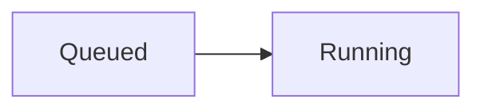

# Design toolkit

[Asset rules and adoption](asset-rules.md) · [Agent CLI interface](agent-interface.md) · [ADG design](design.md) · [Architecture](architecture.md) · [Performance](performance.md)

A project's `design/` directory holds TSX sources that define how its UI looks. The implementation follows them. The `adg` toolkit builds the sources into static frames, checks them, renders them for review, compares them with the running implementation, and browses them in the viewer (`adg <directory>`).

This document is the source format and authoring command contract. The [agent CLI interface](agent-interface.md) defines `--json` output, command data schemas, exit codes and recovery actions. The [design asset rules](asset-rules.md) define layers, ownership, states, frame naming, fidelity and lifecycle, with an adoption guide for existing projects. A project's own mapping and governance documents keep its direction, declared forms, implementation locations, approval process and concrete gaps.

## Install

`adg` is installed once per machine and shared by every project. Projects do not list it in their dependencies.

```sh
npm install -g @whzxc/agent-design-gallery
```

The package comes from the public npm registry. Run the same install again to update. `check`, `render` and `compare` launch Chromium through the Playwright that ships with `adg`; the viewer and the build start without it. When Chromium is missing, those commands stop with the command that installs it for that Playwright version.

A project may set `requires` in `adg.config.mjs`, such as `'>=0.4.0'`. Older versions stop with exit code 2 and the update command, so every contributor checks with the same rules.

## One-time name migration

```sh
adg migrate /path/to/project
adg service migrate
```

`adg migrate [project]` renames `sdg.config.mjs`, `.js` and `.ts`, rewrites `sdg`, `sdg/jsx-runtime`,
`sdg/jsx-dev-runtime` and `sdg:self` imports under the configured design directory, updates editor paths and
`.sdg/` ignore entries in the project's `.gitignore` files, removes the old generated directory and regenerates
`.adg/`. Each change is printed. Repeating the command is safe; mixed old/new config names are refused before
any edits. Commands encountering only an old current-project config require this migration. `diff` migrates a legacy base only in its disposable historical tree and records that migration.

`adg service migrate` moves the entire old hub state directory and replaces its macOS LaunchAgent with the current
Node/CLI paths and previous port. `--state-dir` sets the destination; an existing destination or new LaunchAgent
is refused. The key prefix is updated without printing the key. Afterwards it lists other LaunchAgents referencing
the old path for the operator to update. See [local updates](local-updates.md#one-time-service-migration) for paths
and service migration details.

## Project layout

- `adg.config.mjs`, `adg.config.js` or `adg.config.ts` at the project root configures paths, `sources`, `check` and `compare`. Every field is optional.
- `design/tokens.css` holds color, type, radius, size and shadow tokens for the light and dark themes.
- `design/components/<name>.tsx` holds one shared component. It exports the functions other sources use, and its default export returns the component's declared forms as frames.
- `design/modules/<feature>.tsx` owns feature parts and their states, composed from components and other modules' exported parts.
- `design/surfaces/<name>.tsx` holds a panel, dialog, page or screen composed from components. Its default export returns its declared forms as frames.
- `design/art/` holds SVG illustrations and brand artwork that sources import.
- `design/fixtures/` holds representative content and state data. `design/studies/` holds temporary direction explorations only while they are active.
- `design/implementation.json` optionally maps implementation files/symbols to design parts and frames; see [implementation mappings](#implementation-mappings).
- `design/gallery.json` optionally arranges sources into groups for the viewer.
- `design/tsconfig.json` lets editors resolve the toolkit's types. `adg init` writes it; every command refreshes the ignored `design/.adg/` declarations it points to.
- `output/design/` receives builds, renders and compare reports. Keep it and `design/.adg/` out of Git.

`sources` is an optional array of plain top-level directory names. Since 0.5.0 it defaults to `['components', 'modules', 'surfaces']`, adding `studies` only when a direct `design/studies/*.tsx` file exists. Empty study directories and nested helpers do not enable studies. Saving the first study or removing the last one updates default viewer discovery. Explicit lists retain their exact directories and order, including whether to include studies. Names use letters, digits, underscores or hyphens; nested paths are rejected. Only direct TSX files in those directories are source entries. Other files under `design/`, such as shared scene data, remain imports.

Production directories in `sources` are ordered from lower to higher layers. `check` rejects imports into a higher layer and permits imports within the same layer. With the default order, components cannot import modules or surfaces, and modules cannot import surfaces. Custom names use the configured order; studies are exempt. A consumer can set `check: { importDirection: false }` in `adg.config.mjs` to disable only this lint and document its alternative policy locally. The check uses resolved direct source imports from the relationship graph, including extension/index resolution and re-exports.

Commands run from any directory inside the project. They find the nearest `adg.config.mjs`, `.js` or `.ts` (in that priority order), or, without one, the nearest `package.json`, and resolve paths from there.

## Tokens

`design/tokens.css` has exactly two blocks, `:root { … }` for light and `:root[data-theme="dark"] { … }` for dark. Each declaration sits on its own line. The dark block overrides only the tokens that change.

Sources require `--font-ui`, `--font-mono`, `--canvas` and `--text`. Name the rest by role, such as `--surface`, `--text-secondary`, `--text-body` or `--radius-panel`. A `--shadow-<name>` token is a CSS box-shadow list.

## Sources

Sources are TSX modules that run at build time. JSX produces static markup: there is no React, state, effect or event handling, and the output contains no scripts or event attributes. A component is a plain function of its props. Use `class`, not `className`; other attribute names follow HTML and SVG.

```tsx
import { Frame, Icon } from 'adg';

export function Panel(props: { title: string; children?: unknown }) {
  return (
    <section class="w-[420px] rounded-panel bg-surface p-4 shadow-md">
      <h2 class="flex items-center gap-2 text-title font-semibold text-text">
        <Icon name="plug" />
        {props.title}
      </h2>
      {props.children}
    </section>
  );
}

export default () => [
  <Frame name="ready" fixture="mcp-hub-ready" capture={{ region: 'MCP', viewport: '1280x1200' }}>
    <Panel title="MCP" />
  </Frame>,
];
```

The specifier `adg` resolves to the installed toolkit's runtime. Relative imports resolve within `design/`. Importing an `.svg` file under `design/` yields a component that inlines the drawing and passes its props to the drawing's root; importing a PNG, JPEG or WebP file yields a data URL. `import url from './x.svg?url'` yields a data URL for any file under `design/art/`, preserving self-contained artwork as an image. Packages from npm are not available to sources.

Reuse components and pass parameters instead of copying markup between sources. Generate repeated geometry with ordinary functions and loops in the source.

### Frame

A `Frame` is one declared form of a component or surface.

- `name` is the form name, unique within the source.
- `width` and `height` are CSS pixels. Without width or height, the frame takes its content's size.
- `locale` optionally annotates the authored language with a canonicalizable BCP 47 tag, such as `en` or `zh-CN`. It does not change rendering, load dictionaries or set compare fixture locale. Existing frames are unspecified. `owner --locale` filters the exact canonical annotation, with no language fallback.
- `fixture` names the compare fixture for this form.
- `capture` tells `compare` what to capture in the implementation: `{ region }`, `{ selector }` or `{ page: true }`, each with optional `viewport` (`'<w>x<h>'`) and `clicks` (accessible names, in order). A page capture clips the page at `origin` (`'<x> <y>'`, default `'0 0'`) with the frame's size.
- `parent` declares a new part's original region: `{ source, frame, selector }`, using a project-root-relative `.tsx` or `.mmd` source path with extension, a frame name and a CSS selector. See [Git frame diff](#git-frame-diff). `check` validates shape only; `diff` resolves an active mapping.
- `note` is a caption that the viewer shows in the inspector. It is not part of the drawing.

A frame contains exactly one root element, its shell. `compare` measures design positions from the shell's top-left. The frame paints `var(--canvas)` behind the shell.

### Icon

`<Icon name="<lucide-name>" />` renders Lucide geometry in `currentColor` with a 1.75px rendered stroke. `size` defaults to 16; `class` passes through.

## Styling

Style with Tailwind CSS v4 utility classes. The build compiles only the classes the sources use, against a theme generated from `design/tokens.css`:

| Token | Theme variable | Example classes |
| --- | --- | --- |
| `--<name>` with a color value | `--color-<name>` | `bg-surface`, `text-text-secondary`, `border-border` |
| `--text-<name>` with a length | `--text-<name>` (font size) | `text-body`, `text-meta` |
| `--font-<name>` | `--font-<name>` | `font-ui`, `font-mono` |
| `--radius-<name>` | `--radius-<name>` | `rounded-panel` |
| `--shadow-<name>` | `--shadow-<name>` | `shadow-md` |
| any other token | the token itself | `h-(--control-height)` |

Tailwind's default colors, font sizes, font families, radii and shadows are removed, so those classes resolve only to project tokens. Spacing keeps Tailwind's 4px scale, and arbitrary lengths such as `w-[480px]` or `mt-[19px]` are allowed. Use a `style` attribute only for computed geometry. Sources contain no `<style>` elements.

Paint resolves through tokens. Opacity modifiers on token colors, such as `bg-warning/10`, are allowed. A literal color is allowed only inside an element with `data-brand`. The build defines both token blocks and the root's `data-theme` selects one, so every frame renders in both themes without extra frames. Text uses `font-ui` unless a class says otherwise.

A frame may animate with CSS to show timing and easing. `check`, `render` and `compare` run with motion reduced.

## Authoring

A source describes structure, not coordinates. Write it the way the UI is built.

- Lay out with flex and grid, gap and padding. Sizes follow content; fix a width or height only where the design fixes it, such as a panel, a dialog, a list row or the frame.
- Use whole CSS pixels. Spacing uses the 4px scale where it fits, otherwise an arbitrary whole-pixel value.
- Keep fixture text and repeated items as data at the top of the source and render them with `map`.
- Mark free-form geometry with `data-free`: canvas content, topology, charts, and chrome placed at fixed screen positions. Inside it, `style` may position elements with values computed from data.
- Outside `data-free`, `style` sets only width, height and custom properties.

## Presentation forms

- The user declares the forms each source contains, such as three densities of one card.
- Draw only declared forms. Do not add frames for combinations of theme, width, locale or interaction state.
- Themes come from tokens. Every source renders in both themes without extra frames.
- Each source shows one representative language.

## Check

`check` builds every source and loads each frame in Chromium in both themes. It reports:

- a build or render error, with its source location;
- invalid implementation mapping declarations or stale bindings; see [mapping findings](#validate-mappings);
- a duplicate frame name, a frame without exactly one root element, or an invalid `capture`;
- a computed text, background, border, outline, fill, stroke or shadow color that matches no token value in the active theme, outside `data-brand`;
- text that overflows its box without an ellipsis, leaves the frame, or overlaps other text;
- content that overflows the frame's declared width or height;
- a `<style>` element, script or event attribute in the output;
- a fractional pixel length in a class or style outside `data-free`;
- a `style` outside `data-free` that sets anything but width, height or custom properties.

Each problem is one line, `<path>: <frame>: <problem>`. Completed rule findings exit 1. Build or frame-execution failures exit 2; `--json` returns `complete: false` with the observed partial findings. A completed check uses `complete: true`, with `CHECK_FAILED` when findings remain.

An import-direction problem is one line, `<path>: import <source> violates import direction (<lower> -> <higher>); ...`. It names the resolved source rather than a manual dependency annotation. Named-source checks lint those sources' outgoing imports, including targets outside the selected subset. Other imported helpers and erased type-only imports are outside the graph; review their ownership in the [read-only audit](asset-rules.md#2-run-a-read-only-audit).

## Implementation mappings

Since 0.9.0, the optional `design/implementation.json` is the machine-readable source
of UI implementation counterparts. It lives under the configured design root when
that root differs from `design/`. It is independent of `Frame.parent` (diff crop
metadata), gallery grouping and architecture sidecar `owners`.

```json
{
  "version": 1,
  "mappings": [
    {
      "implementation": { "file": "ui/controls.tsx", "symbol": "Button" },
      "design": [{ "source": "design/components/button.tsx", "part": "Button", "frames": ["primary", "disabled"] }]
    },
    {
      "implementation": { "file": "ui/controls.css" },
      "design": [{ "source": "design/components/button.tsx", "part": "Button" }]
    },
    {
      "implementation": { "directory": "ui/settings/" },
      "design": [{ "source": "design/surfaces/settings.tsx" }]
    },
    {
      "implementation": { "glob": "ui/dialogs/**/*.tsx" },
      "design": [{ "source": "design/modules/dialog.tsx", "part": "Dialog" }]
    },
    {
      "implementation": { "file": "ui/settings.vue", "symbol": "SettingsPanel", "anchor": "<!-- SettingsPanel -->" },
      "design": [{ "source": "design/surfaces/settings.tsx", "frames": ["ready"] }]
    }
  ]
}
```

The loader is strict: version must be 1; unknown keys are invalid. `mappings` may be
empty, but each mapping needs one selector and a nonempty `design` array. Bindings
are many-to-many and overlapping selectors are allowed; duplicate identical bindings
are findings. No `lines` field exists in version 1.

- Select exactly one `file`, `directory` or `glob`. Paths are case-sensitive,
  project-root-relative POSIX paths. Reject absolute paths, backslashes, `.`/`..`
  segments, empty segments, `#` fragments, colons and control characters. A directory
  ends in `/`. Globs support `*`, `?` and whole-segment `**`, without braces, brackets,
  negation or extglobs. Escaping symlinks are invalid. Recursive expansion skips
  `.git`, `node_modules`, `.adg` and configured generated output.
- Only a file selector accepts `symbol` and optional `anchor`. `symbol` is an exact
  nonempty label; an anchor requires a symbol. For `.ts/.tsx/.js/.jsx/.mjs/.cjs`, an
  unanchored symbol resolves lexically to exactly one declaration line matching the
  following pattern after CRLF normalization (`<symbol>` is escaped literally):

  ```regex
  ^export\s+(default\s+)?(async\s+)?(function\*?|class|const|let|var)\s+<symbol>\b
  ```

  This requires an export declaration starting at column 1. It does not parse an AST,
  follow re-exports or resolve a second variable in a multi-declarator statement. Zero/multiple matches yield
  `OWNER_LOCATOR_STALE`; add an explicit anchor. Non-exported symbols need an anchor;
  other file types require one at schema validation. An explicit anchor is a literal,
  case-sensitive substring that must occur exactly once in the CRLF-normalized file.
  It can span lines; its first line is the boundary. It overrides automatic resolution.
- `design[].source` names a discovered TSX entry, project-root-relative with extension.
  `part` names an exported function in that defining source, never a component merely
  imported there. Omit `part` for an inline/whole-source composition. Without `frames`,
  a part selects all frames containing its stamped identity; without a part it selects
  every frame. An explicit nonempty `frames` list uses exact names and each named frame
  must contain the part when supplied. A part without a specimen remains a valid binding
  but lookup warns `OWNER_PART_UNOBSERVED`. Mermaid ownership lookup is a later item.

Line queries use export/anchor regions rather than authored absolute line ranges.
Every lexical JS/TS export starts a boundary, mapped or not; declared anchors add
boundaries. In other files only declared anchors do. A helper belongs to the preceding
export region. Unmapped and pre-boundary lines fall back to file-level bindings with
`OWNER_LOCATOR_UNMAPPED`. The [owner contract](agent-interface.md#owner) defines region
reporting, ranking, evidence and empty/ambiguous results.

### Validate mappings

```sh
adg check --read-only --json
adg owner --file=ui/controls.tsx --symbol=Button --json
```

`check` reads the optional map without changing it; absence is compatible with existing
projects. A full check validates every binding. A named-source check validates targets
in the selected design sources. Mapping findings identify implementation.json, a JSON
pointer and 1-based value-token line/column when available.

| Finding | Repair |
| --- | --- |
| `OWNER_IMPLEMENTATION_MISSING` | Restore the file or update a selector that matches no files. |
| `OWNER_LOCATOR_STALE` | Add/repair an anchor or fix the symbol's unique declaration. |
| `OWNER_MAPPING_DUPLICATE` | Remove the duplicate selector/target binding. |
| `OWNER_SOURCE_MISSING` | Fix the design path or configured discovery. |
| `OWNER_PART_MISSING` | Use an export in the defining source. |
| `OWNER_FRAME_MISSING` | Update an explicit frame name. |
| `OWNER_PART_FRAME_MISMATCH` | Bind frames that actually contain the declared part. |

Completed findings use `CHECK_FAILED`, exit 1. Invalid JSON, version, keys or path/anchor
shape uses `OWNER_MAP_INVALID`, exit 2. Build/runtime failures retain their normal
execution codes. `--read-only` skips generated declarations and build files. Lookup
excludes stale bindings, reports them in `mappingFindings` with `OWNER_MAPPING_STALE`,
and retains valid answers with exit 0. Run full check to find stale bindings outside a
file query's selection.

### Migrate a mapping table

1. Convert a small representative slice first. Translate a human `ui/controls.tsx#Button`
   counterpart into separate `file` and `symbol` fields; do not put `#Button` in a path.
2. Keep design identities exact. Use one mapping's `design` array for multiple targets,
   `frames` for an actual subset, a `part` only in its defining source, and no `part`
   for an inline composition. Use an exact style-file binding where appropriate.
3. Let exported JS/TS symbols resolve automatically. Add anchors for non-exported or
   other-language symbols. Prefer a meaningful existing marker to adding a redundant
   comment for every exported function.
4. Run read-only check and representative file, symbol and line queries. Fix stale
   findings before expanding the migration; verify returned frame subsets.
5. Keep approval, adoption, drift and review notes in the human document. Link to
   implementation.json for counterpart facts and remove duplicated mapping rows as
   they are migrated. ADG does not rewrite existing tables automatically.

Consumers using the feature can set `requires: '>=0.9.0'` in their ADG config.

## Workflow

1. Start from the user's request and the fixture data the frame will be compared against.
2. Write or update the source, reusing components.
3. Run `check` and fix every problem.
4. Run `render` and review both theme renders against the layout review.
5. Show the renders to the user and iterate until they approve them.
6. Implement with the project's shared components and runtime tokens.
7. Run `compare` for the frame's fixture and review the overlay. Fix structural differences and systematic offsets. Accept small isolated offsets when the implementation reads as well as the design.

A frame uses the language and text of its fixture, including dates under the fixture clock and time zone. A drafter may propose forms. Approving the renders approves those forms. Frames whose state the implementation cannot reach have no fixture; record them in the project's design doc as drift instead of forcing a capture.

A new project starts with a visual direction before any source: two or three specimen frames that differ in palette, density and chrome, one chosen by the user. Then tokens, then the component sources, then one pilot surface taken through implementation and `compare` before the remaining surfaces.

## Layout review

Review the composition of every frame before showing it. A frame that copies the current implementation also copies its layout problems.

- Group by meaning. Items that serve one decision sit together, and the gap between groups is clearly larger than the gap inside a group.
- End a decision with one action row. Attach scope and consequence text to the title or content it qualifies.
- Settings use one setting per row, with its name and effect on the left and its control on the right. Group rows by the scope they affect.
- Join short metadata into one line with ` · `. A short status or count does not own a row.
- Give a row or step at most a title and one meta line.
- Show each state once.
- Pad a container equally on all sides. Its height follows its content.
- Give an overlay one dismissal. Do not add a footer button that repeats close.
- Keep navigation, filters and actions apart. Panel actions sit with close in the header. Filters share one toolbar row.
- Keep a transition in place. A running action turns its own control into the pending state and disables its siblings.
- Anchor a menu or popover to its trigger, with the trigger in its open state.
- Floating chrome never hides the only copy of a label. A label that would collide with chrome or another label is omitted.
- Cut advisory text that the user does not need in order to act.

## Commands

```sh
adg [open] [directory] [--port=<n>] [--no-open] [--state-dir=<path>]
adg init
adg check [source...] [--read-only]
adg render [source...] [--frame=<name>] [--theme=both|light|dark] [--scale=2] [--out-dir=<path>] [--json]
adg compare <source> --frame=<name> [--fixture=<name>] [--region=<name> | --selector=<css> | --page] [--origin=<x> <y>] [--click=<name>...] [--viewport=<w>x<h>]
adg compare --all
adg diff [source...] --base=<rev> [--frame=<name>] [--theme=both|light|dark] [--scale=2] [--out-dir=<path>] [--json]
```

A first argument that names a command runs it; any other argument is a directory to open. `adg open check` opens a directory named `check`.

- `init` creates `adg.config.mjs` requiring `>=0.5.0`, required tokens, production source directories, fixtures/art, editor configuration and ignore entries. A fresh library gets `components/example.tsx`, `modules/example.tsx`, `surfaces/example.tsx` and `fixtures/example.ts`: one runnable downward composition with frame name `default` in each source. Explicit source names are used in place of the defaults. Existing source libraries or an existing example fixture receive no demo assets. Authored files are preserved, generated declarations are refreshed, missing ignore entries are appended, and created/skipped files are listed. It creates no study or empty studies directory.
- `check` checks import direction and the named sources' frames, or all sources. `--read-only` skips generated type declarations and HTML build files; it runs the same import and both-theme frame checks without changing consumer files.
- `render` writes `output/design/<path>/<frame>-light.png` and `-dark.png` at the given scale, for every frame or the one named.
- `compare` compares one frame; its flags override the frame's `fixture` and `capture`.
- `diff` compares Git base and working-tree frames, writes PNGs and a machine-readable report, and gates ordinary changes or structural parts. It defaults to both themes at 2×.
- `compare --all` compares every frame that has a fixture and writes `output/design/compare/summary.json` and `index.html`, one row per frame with its counts and report link.

Each design capture in `render` and `compare` uses a fresh page and browser context, including between themes, so PNG bytes are independent of frame order. `render` reuses one Chromium process for the batch, runs up to four captures concurrently within the available CPU parallelism, and closes each page after capture. Console output follows source, frame and theme order.

Source arguments are paths under the design directory, with or without `design/` and `.tsx`. Exit codes are 0 for success, 1 when `check`, `compare` or `diff` found problems, and 2 for a usage, configuration or environment error, with one line on stderr naming the fix.

## Git frame diff

```sh
adg diff --base=HEAD --json
adg diff modules/toolbar --base=HEAD~1 --frame=compact --out-dir=output/review --json
```

`diff` compares the source/frame union at a Git revision and in the current working tree.
Omitting sources includes configured TSX and architecture sources at either revision;
explicit selection and `--frame` limit the capture. Base-only and current-only frames
remain visible. `--theme` defaults to `both`, `--scale` to 2 and the output to
`<configured output>/diff`. Relative output directories resolve from the project root.
See the [agent contract](agent-interface.md#diff) for schema, artifacts and recovery argv.

Ordinary matched frames are `identical` only with exact decoded pixels and equal CSS
and device sizes. Additions/removals, size changes and suggested renames are `changed`.
No tolerance setting changes ordinary-frame exactness. The Git base uses its own
config, tokens, imports and artwork, with the current installed runtime/dependencies.
Legacy base migration changes only the disposable historical tree and is reported.
Diff does not call compare adapter callbacks.

Declare an extracted part on its new Frame:

```tsx
<Frame name="compact" width={320} height={48} parent={{
  source: 'design/surfaces/home.tsx',
  frame: 'ready',
  selector: '[data-part="toolbar"]',
}}>
  <Toolbar />
</Frame>
```

The parent reference has exactly `source`, `frame` and `selector`, all nonempty strings.
The source is a canonical project-root-relative `.tsx` or `.mmd` path with `/` separators;
absolute paths, backslashes, colons and empty/`.`/`..` path segments are invalid.
`check` validates this shape without resolving a source or executing the selector.
Only selected current-only TSX frames activate a mapping. Both parent revisions must
contain that same source/frame and exactly one visible selector target. A mapping may
stay in source after adoption; it is inactive when the part already exists at base.
`capture` remains implementation-fixture metadata for `compare` and supplies no mapping.

The part's single root must fill its standalone Frame. Its snapshot geometry is
root-relative, preserving exact local subpixel offsets. The parent crop copies device
pixels with outward floor/ceil rounding; it is never resampled or registered to fit.
Clipping is recorded, and a target outside its full parent frame cannot be structural.
Part evidence compares the current subtree and both parent target subtrees, including
hidden descendants, direct text/line boxes, semantic attributes, image bytes, computed
layout/paint, backdrop/clipping effects and the complete active token map. Any mismatch
fails the part even with zero pixel difference. Readiness waits for fonts/images, then
two equal observations and an unchanged post-capture observation within five seconds.
Ordinary frames collect none of these snapshots.

Configure the consumer's resolved limits in `adg.config.mjs`, `.js` or `.ts`:

```js
export default {
  diff: {
    thresholds: {
      imperceptible: { maxChannelDelta: 2 },
      antialiasing: { maxChannelDelta: 48, maxRatioExclusive: 0.005 },
      boundaryBleed: { edgeDevicePixels: 2 },
      bitmapResampling: { maxRatioExclusive: 0.001 },
    },
  },
};
```

These are the defaults. Omitted individual fields inherit them. Unknown keys, nulls,
arrays, nonnumeric or nonfinite values are invalid (`CONFIG_INVALID`). Channel deltas
are integers in `[0,255]`, ratios are in `[0,1]`, and edge width is a nonnegative integer.
A zero allowance permits zero pixels through that class. Current policy is resolved in
all reports; base policy is recorded in `environment.baseThresholds` without overriding it.
There is no snapshot/geometry epsilon or ordinary-frame tolerance.

Classifier version **1** decodes sRGB RGBA and canonicalizes transparent RGB to zero.
Delta is the maximum absolute RGBA channel difference. Each unequal pixel receives one
class, in precedence order **imperceptible → boundary bleed → bitmap resampling →
antialiasing → other**. Candidate counts remain visible when a budget fails.

| Class | Version 1 rule |
| --- | --- |
| `imperceptible` | Positive channel delta at most 2 by default; no count limit. Snapshot mismatches still fail. |
| `boundary_bleed` | Within the configured device-pixel edge band (default 2), full-parent pixel differs from isolated parent and the part pixel exactly equals isolated parent. No count/channel limit. |
| `bitmap_resampling` | Same raster owner, resource bytes, intrinsic size, box, interpolation, object fit/transform and snapshots; only the intersected visible, unoccluded raster region qualifies. Default positive count / crop area must be strictly below 0.001. Vector SVG and CSS backgrounds receive no raster allowance. |
| `antialiasing` | Matched text/shape/border region, matching snapshots, delta at most 48 and the stable-anchor test below. Default positive count / crop area must be strictly below 0.005. |
| `other` | Everything else, including interior external paint; any such pixel fails. |

The antialiasing test uses a clipped 3×3 neighborhood. Two distinct anchor RGBA colors
must each occur at least three times at unchanged coordinates in both images, have
nonzero luminance contrast and channel contrast above the imperceptible limit. Both
candidate colors must be convex blends of the anchors, with per-channel residual at
most 2. At least one candidate must differ from **both** anchors by channel delta
**greater than 2**. Near-anchor-to-anchor flips do not count as a strict intermediate.
An edge lacking stable anchors remains `other`; a text box alone grants no allowance.
The residual 2, neighborhood and anchor requirements are fixed in classifier version 1.
At defaults, delta 49 fails AA; 50 AA pixels or 10 raster pixels in a 10,000-pixel crop
fail their respective strict budgets. Zero candidates pass a ratio limit of zero.

Matching snapshots, equal device extents and any remaining nonimperceptible difference trigger a **single
isolation capture per parent target and theme**, shared across parts using that target.
It hides outside sibling subtrees with temporary visibility overrides while preserving
layout, target, ancestors and clipping/compositing; styles are restored afterward.
Target snapshots must remain equal around isolation. The capture rules out outside
paint even inside raster/edge regions: interior external paint stays `other`, never AA
or bitmap resampling. Unsupported paint produces `DIFF_SNAPSHOT_UNSUPPORTED`; unstable
observations produce `DIFF_UNSETTLED`.

A new mapped part is locally `structural` only if both complete parent renders remain
identical in both themes, target/part snapshots and sizes agree, no `other` pixels
remain and every class budget passes. An exact extraction is also structural. Full
batch `structural` additionally requires every existing frame in the revision union,
in both themes, to be identical. Restricted selection reports partial coverage and
cannot yield a structural batch; locally passing evidence remains in its rows. One
requested theme fails a part with `theme_coverage_incomplete`, without silently rendering
the other theme. Exit 0 means `identical`/`structural`, exit 1 is completed `changed`
(`DIFF_FAILED`), and exit 2 is incomplete execution. Review visual differences through
the consumer's normal approval process.

## Review handoff

After changing design assets, name the change and include an ADG link for each affected frame, source, or cohesive group. Choose the smallest target that covers the change. For example, report “Button disabled state — adjusted the foreground contrast” with a link to that frame. Add a PNG when the report needs an inline preview or the recipient cannot reach the viewer.

| Need | Command |
| --- | --- |
| Live preview of the working directory | `adg open ./design --asset=components/button.tsx --frame=disabled --no-open` |
| Share the changed frame on a registered project | `adg link https://gallery.example/p/project/ --asset=components/button.tsx --frame=disabled` |
| Include the frame's source layer for context | Add `--mode=path` to the link command. |
| Export PNGs for a report or another tool | `adg render components/button --frame=disabled --theme=dark --out-dir=output/review --json` |

`open` and `link` accept one target: `--asset` with an optional `--frame`, `--group`, `--layer`, or `--tokens`. Source paths are relative to the design directory and include the extension. Query mode is the default. To convert a URL copied from the viewer, pass it to `adg link` without target flags. `link` emits a single URL and strips unrelated query parameters, including access keys. Share a reachable hub project URL for remote review and verify that it serves the changed checkout. A direct preview uses loopback. A proxied instance link lasts until its viewer stops. Viewer links reflect the current source files and refresh after saves. Keep the PNG when the report needs a fixed snapshot.

`render` exports TSX frames at their exact bounds. It defaults to both themes at 2×. `--theme` selects a theme, and a relative `--out-dir` resolves from the project root. `--json` emits one versioned envelope. `data.captures` is ordered by selected source, frame, then light before dark; each capture contains project-root-relative `source` with `/` separators, `frame`, `theme`, absolute PNG `path`, `scale`, CSS `width`/`height` and actual PNG `pixelWidth`/`pixelHeight`. `data` always contains `project`, `outputDirectory`, `complete`, `base`, `captures` and `deleted`, including `base: null` and `deleted: []` without a base. Failed batches advertise completed PNGs only. Human logs go to stderr under `--json`; default text output remains available for interactive use.

## Architecture sources

A project may keep one Mermaid diagram per `.mmd` file. The config's `arch` directory
is relative to the project root, independent of `design` and the TSX `sources` list.
When omitted, `arch` is enabled if `<root>/arch` contains at least one `.mmd`, recursively.
`arch: false` disables it. Only regular `.mmd` files and their adjacent `.md` sidecars
participate; JSON, other files, hidden entries and symlinks are ignored.

```js
export default {
  design: 'design',
  arch: 'arch',
  check: { archMaxEdges: 30 },
};
```

Every diagram becomes one artboard with one frame named `default`. Architecture paths
are project-root-relative, including the configured directory and extension:
`arch/mechanisms/work.mmd`. Existing TSX paths remain design-relative. The viewer puts
architecture sources in its `arch` layer and groups them by subdirectory. Contents,
search, Fit, Render only, Inspector notes, query/path links and the hub proxy use the
same frame pipeline. Architecture nodes have empty Uses and Used by lists.

Leading `%%` comments are allowed. Express semantics with Mermaid class statements:



| Class | Meaning and paint |
| --- | --- |
| `progress` | In progress; violet fill/stroke. |
| `waiting` | Waiting; warning fill/stroke. |
| `done` | Complete; success fill/stroke. |
| `stopped` | Stopped; danger fill/stroke. |
| `uncertain` | Uncertain; tertiary fill/stroke. |
| `experimental` | Experimental border; violet, 2px, 6/4 dashed. |
| `temporary` | Temporary border; warning, 2px, 2/3 dashed. |
| `gap` | Gap border; danger, 2.5px solid. |

A phase and a mark combine: the phase supplies the fill, and the mark the border.
The legend above the diagram lists only used classes; it is omitted for unclassified
diagrams. Unknown classes fail checks. `added`, `removed` and `changed` are reserved
for computed Git overlays and rejected in sources. Use the [review overlay](#review-overlays) to compare a working-tree proposal with a Git revision.

Sources do not paint. `classDef`, `style` and `linkStyle` statements are rejected,
as are init directives or Mermaid frontmatter containing theme, themeVariables or
color/paint configuration. Paint is supplied by `design/tokens.css`, which retains
its required light/dark blocks and four required tokens.

The frame maps Pele variables to project roles: background to `--surface` then
`--canvas`, foreground to `--text`, muted to `--text-secondary`, line to
`--text-tertiary`, surface/alternate to `--surface-subtle`, border to `--border-strong`
then `--border`, accent to `--accent`, and fonts to `--font-ui`/`--font-mono`.
Missing optional neutral roles fall back to canvas/text. Radius is 8px.
Projects may override `--arch-<class>` in either token block. Defaults use violet
`#6a5ad0`/`#ab9fff` for progress and experimental; warning, success, danger and
tertiary roles supply the remaining colors with ADG light/dark fallbacks. Phase
fill mixes 20% of its color with the diagram background.

### Sidecars

`work.md` beside `work.mmd` supplies an English prose note. Its optional frontmatter
supports exactly two keys, once each. `owners` is an indented dash list; `status` is a
non-empty single-line string. Values may be bare or surrounded by matching single
or double quotes. Inline arrays, nested objects, escapes, multiline scalar syntax,
comments and additional YAML features are unsupported. No YAML dependency is used.

```md
---
owners:
  - src/queue.ts
  - src/workers/**/*.ts
status: Draft
---
Review the queue before changing its delivery policy.
```

Owners are project-root-relative file paths or filesystem globs (including `*`, `?`
and `**`); each must match at least one file. Absolute and parent-escaping paths are
invalid. The body appears in the existing Inspector note, followed by plain
`Owners: ...` and `Status: ...` lines when present. These mappings are for review;
ADG does not infer architecture layers or freshness from them.

### Architecture check and render

```sh
adg check arch/mechanisms/work.mmd --read-only
adg render arch/mechanisms/work.mmd --theme=both --scale=2 --out-dir=output/arch --json
adg open . --asset=arch/mechanisms/work.mmd --frame=default
adg link http://127.0.0.1:4310/p/example/ --asset=arch/mechanisms/work.mmd
```

`check` includes architecture sources when no sources are named, and accepts named
architecture sources with or without `--read-only`. Each problem occupies one line
`<project-relative-path>: <problem>`. It reports Pele's parse message and original
line, unknown/reserved classes, painting statement lines, an edge/message count over
`check.archMaxEdges` (default 30), invalid sidecars, unmatched owners, and labels
outside their node shapes in either theme. The count is a check limit; it does not
prevent browsing or rendering a larger diagram.

Pele renders synchronously in Node. ADG collects its text-width requests and measures
them in Chromium using both project font stacks, repeating as wrapping requests new
widths. Layout reserves the larger width across themes. Rendered shape checks use
Chromium's actual SVG transforms and text bounds. Final font review uses macOS,
the review platform defined in [ADG design](design.md).

`render` uses a fresh page/context per frame and theme, defaults to both themes at
2×, and writes `<out-dir>/arch/mechanisms/work/default-light.png` and
`default-dark.png`. `--json` returns the same capture envelope used for TSX, with architecture sources relative to the project root in `data.captures`.
A named architecture render writes no declarations or HTML into the source checkout;
use an absolute output directory to keep a consumer checkout read-only.

## Review overlays

`--base=<rev>` on `render`, `open` and `link`, or `?base=<rev>` in a viewer locator,
compares architecture sources in the working tree with a Git commit. Uncommitted
proposals are supported. Revision names, branch names, tags and commit expressions
are resolved to a commit SHA once per render/manifest/source request; the base source is read
with `git show <sha>:<repository-relative-path>`. Links carry the requested revision
and resolve it in the destination project's repository. Both direct viewers and hub
project/instance proxies retain the query parameter through navigation.

```sh
adg render arch/mechanisms/work.mmd --base=HEAD --theme=both --json
adg open . --asset=arch/mechanisms/work.mmd --base=main
adg link https://gallery.example/p/project/ --asset=arch/mechanisms/work.mmd --base=HEAD~1
```

Source paths may be project-relative or absolute paths resolving inside the project
root. TSX-only named renders ignore `base` and retain their existing output format;
TSX comparison remains roadmap milestone 4. Normal builds without `base` retain the
same frame bytes, content hashes and JSON array format.

Comparison uses Pele models:

- Flowchart nodes and subgraphs match by ID. A changed label, shape or parent marks
  the element as changed. Edges match by endpoints and occurrence among edges with
  those endpoints; their new label and connection shape are compared. Changed
  invisible layout edges become visible diff lines so the connection can be reviewed.
- States match by ID, including composite states. Labels and parents are compared.
  Transitions match by endpoints and occurrence in the flattened state graph,
  including transitions inside composite states.
- Sequence participants match by ID. Messages align by longest common subsequence
  of `(from, to, text)`. Unmatched messages are added/removed; an adjacent removed
  and added pair with the same endpoints is changed and shows the new label.

The overlay model keeps current elements and adds removed elements as ghosts.
A ghost node returns to its base parent if that parent exists in the current model,
otherwise to the root. Ghost edges connect current or ghost endpoints. Pele lays out
this combined graph; positions are recomputed, rather than frozen to base coordinates.
Sequence control blocks follow the current source while removed messages remain in
the timeline. Other diagram types, or a change between diagram types, render the
current source with an Inspector note that comparison is unsupported.

The source's phases and marks remain in force. Computed diff borders override mark
borders while preserving phase fills:

| Diff | Nodes | Edges/messages |
| --- | --- | --- |
| `added` | 2.5px solid border | 2.25px stroke, matching arrowheads, `+ ` label prefix |
| `changed` | 2.5px dashed 4/3 border | 2.25px dashed stroke, new label |
| `removed` | 0.5 opacity, dashed 5/4 border | 0.5 opacity, dashed stroke, `- ` label prefix |

`--arch-added` and `--arch-changed` default to `--accent`; `--arch-removed` defaults
to `--text-tertiary`, with theme fallbacks when the roles are absent. Projects can
override these variables in either token block. The in-artboard legend includes the
diff classes in use and `Compared with <short-sha> (<rev>)`. Inspector notes append
plain-text changes, such as `+ state cancelled` or
`~ transition awaiting -> reserved: approved -> approved locally`. All comparison
visuals stay inside artboards; the viewer chrome is unchanged.

A file absent at base renders as entirely added. A deleted current diagram is not
rendered. With an architecture base, `render --json` uses the same envelope and fills
`data.base` with the requested revision and resolved commit, for example:

```json
{
  "schemaVersion": 1,
  "command": "render",
  "ok": true,
  "data": {
    "project": "/project",
    "outputDirectory": "/project/output/design",
    "complete": true,
    "base": { "rev": "HEAD", "sha": "0123456789abcdef0123456789abcdef01234567" },
    "captures": [
      { "source": "arch/mechanisms/work.mmd", "frame": "default", "theme": "light", "path": "/project/output/design/arch/mechanisms/work/default-light.png", "scale": 2, "width": 640, "height": 360, "pixelWidth": 1280, "pixelHeight": 720 }
    ],
    "deleted": ["arch/removed.mmd"]
  },
  "warnings": [],
  "error": null
}
```

Unnamed renders include deleted diagrams from the configured architecture directory
at base; naming sources limits both captures and deletions to that selection. Git
missing, a project outside a Git repository or an unknown revision produces an error
with a next action. Overlay build stores are separate from normal build stores.
Their identity includes the base commit, base blob hash, displayed revision and current
source/sidecar/token inputs; geometry and preview caches remain separated by their
content hashes and base context. Visiting an overlay does not replace normal cache
entries. Saving the working tree refreshes both paths through the existing watcher.

## Compare

`compare` builds the frame and renders it in Chromium beside the implementation in the fixture's theme, locale, time zone and clock. The capture comes from the frame's `capture`, overridden by flags. A page capture sets the viewport and clips the page at `origin` with the frame's size; `region` captures the element with role `region` or `dialog` and that accessible name; `selector` captures the first element matching a CSS selector. Each click activates the first visible control with that exact accessible name among buttons, radios, tabs, checkboxes, switches, menu items, options and links. After the clicks, `compare` waits until the captured texts and their boxes stay unchanged for 300ms, up to 5s.

Both sides are read the same way. The reader takes one text per rendered line, including the placeholders of empty fields, and skips text clipped outside the captured element. Adjacent texts on one line with less than one space between them read as one text. `aria-hidden` on the capture target and its ancestors is ignored; `aria-hidden` subtrees inside it are skipped. Texts pair by content, and repeated texts pair with the nearest position first. Positions are relative to the frame's shell and to the captured element. It reports anchored-edge, vertical-center and width differences above 2px, plus texts missing from either side. It does not compare shapes, so review the overlay as well.

`output/design/compare/<source>-<frame>-<fixture>/` receives `design.png`, `implementation.png`, `overlay.png`, `report.json` and `index.html`. `report.json` records `settled: false` when the texts did not settle; that is an incomplete evaluation and exits 2. Completed text/position differences exit 1. Missing targets and adapter, browser or capture failures exit 2. Under `--json`, both single and all modes return `data.comparisons`, `skipped`, aggregate `summary`, completed artifact paths and `complete`; a failed batch retains observed results with `complete: false`. Empty selections exit 0 with `EMPTY_SELECTION`. Treat them as a review list, not a zero gate. Missing or extra texts, wrong order or grouping, and one offset shared by many texts point to real defects, such as a lost font rule or a leftover border. An isolated offset of a few pixels can stay.

The project describes how to run its implementation in `adg.config.mjs`:

```js
export default {
  requires: '>=0.4.0',
  design: 'design',
  output: 'output/design',
  compare: {
    port: 5188,
    viewport: '1280x800',
    // Starts the app under test and returns a function that stops it.
    async start({ port, root }) {
      const { createServer } = await import('vite');
      const server = await createServer({ root, server: { port, strictPort: true }, logLevel: 'error' });
      await server.listen();
      return () => server.close();
    },
    // Resolves a fixture name to the page to open and its environment.
    fixture(name) {
      return { url: `/?scenario=${encodeURIComponent(name)}`, theme: 'light', locale: 'en-US', timezone: 'Asia/Shanghai', clock: '2026-01-01T00:00:00Z' };
    },
    // Resolves once the page shows the fixture; throws to fail.
    async ready(page, name) {
      await page.waitForFunction(n => document.documentElement.dataset.scenarioReady === n, name, { timeout: 15000 });
    },
    // Request patterns to abort, so fixtures never reach live services.
    block: ['**/api/**'],
    // Optional: texts the page draws outside the DOM, such as on a canvas.
    async texts(page) { return []; },
  },
};
```

- `start` is optional when `url` values are absolute and the app already runs.
- `fixture` returns `url`, relative to `http://127.0.0.1:<port>` or absolute, plus `theme` (`light` or `dark`), `locale`, optional `timezone` (an IANA name) and `clock`. A `clock` fixes `Date` and `Date.now()` while timers keep running. Motion is reduced.
- `ready` defaults to the page's `load` event. A fixture name may stand for a scenario plus preparation steps that `ready` performs.
- `texts` returns `{ text, x, y, width, height, fill, size, weight, family }` entries in page coordinates. They join the DOM texts inside the captured element.

## Viewer conventions

The viewer reads the same sources and rebuilds a source, and the sources that import it, when it is saved. A component source is one set of its forms; a surface source is one flow of its frames. Frame notes appear in the inspector. `gallery.json` lists groups of source paths; unlisted sources stay in directory groups. See the [README](../README.md) for viewer controls.

Since 0.4.5, clicking a frame selects that variant. Clicking a source title selects its source; title clicks also retain copy-name behavior, while the copy icon alone leaves the selection unchanged. Escape clears the selection. Back restores the preceding selection and camera. Drag, pan, zoom, double-click and Enter focus remain available.

The right inspector follows the selection and remembers whether it is expanded, including across navigation and reload. It opens by default; the toolbar Inspector control and the panel's collapse control toggle it. It shows the source path and frame name with copy controls, dimensions and a scrollable frame list. A source selection has no selected variant. A selected frame keeps its outline and frame name through reload. An element selection shows its owning source and export, the host frame name and the element's dimensions, plus **Frames using this export** from the owning source. Clicking one selects and focuses that variant. The relation lists live in this inspector; the left sidebar remains source navigation and search.

**Uses** and **Used by** include direct and transitive sources, grouped by directory (`surfaces`, `modules`, then `components` for the standard composition layers). Direct entries precede indirect entries in each group. An indirect entry is muted and shows its shortest `via` path; equal-length routes use source-path ordering. Each source appears once and the selected source is excluded from cyclic traversals. For example, `surfaces/home → modules/home → modules/composer` displays `composer · via home`. A direct import takes precedence over an indirect route to the same source. Click an entry to select and focus its source; Back returns to the previous frame or element.

The graph comes from imports resolved by the existing bundler, including relative extensions, directory indexes and re-exports. Only TSX entries directly in configured `sources` directories are nodes. Fixtures, nested helper modules, tokens, artwork and the `adg` runtime are excluded. Imports removed by the TypeScript transform, such as type-only imports, are excluded. Saving, adding or removing a source updates relationships through the existing file watcher.

The build registers named exported functions from configured sources by their function identity, including aliases. Static JSX rendering stamps their HTML/SVG roots with `data-adg-owners`, preserving nested exports that return the same root. Fragments and arrays stamp each element root without adding wrappers. The default export remains the frame renderer. During the viewer's existing preview measurement, it records each stamped root's bounds, clipped to the frame and scrolling ancestors. Hover outlines the innermost root under the pointer; click selects it. Matching frames are those whose rendered roots contain the same source/export identity. Camera input only transforms these recorded bounds; it never reruns the page components. Plain text returns have no element root to hit, and unexported helper functions do not introduce a source boundary.

For non-interactive inspection, `GET /relationships` on the local viewer server returns the direct graph, keyed by source path with `uses` and `usedBy` arrays. For example, `curl http://127.0.0.1:<port>/relationships`. It reuses compiled source caches; asset responses carry direct source paths in `imports` and root stamps in frame HTML. The viewer derives shortest transitive routes from that graph. `window.__adg.selection` exposes the host source, frame name and selected element's owning source/export for local automation.

## Limits

- Sources name the system font stack. Linux renders use fallback fonts, so final visual review runs on macOS.
- Frames are static. They do not show hover response, focus movement, dragging, springs or interruption; a state the user declares is its own form.
- An `.svg` file directly in `design/components/` or `design/surfaces/` stops a command that runs over all sources, including `compare --all`, with exit code 2 and names the file to convert. Commands that name sources check only those, so a project can convert in stages. Illustrations belong in `design/art/`.

## Resident discovery

`adg root add <dir> [--depth 2]` registers a scan root; `root remove`, `root list` and `root scan [dir]` manage it without browser filesystem input. Only a config file identifies a hub project. TypeScript configs are bundled with the existing esbuild and keep relative imports and `import.meta.url` rooted at the original config. `adg serve` runs the resident hub; `adg open <dir>` remains a standalone ephemeral viewer. Config `name` overrides the directory basename in project metadata, and `requires` reports compatibility against the running hub version. Opening an incompatible project returns the normal update guidance. Scanning never builds frames; frame counts become available after viewer builds.


## Viewer access contract

`adg open` uses a random loopback port and registers an independent instance record; `GET /api/health` identifies it with `{ id, capabilities: { keyAuth: 1 } }`. The resident hub lists live instances and proxies compatible ones under `/i/<id>/` using their own code. Older or custom viewers must implement the shared localStorage/header/query protocol and advertise that capability before they can be proxied. No project dependency on the resident hub is introduced.

HTML/JS shells remain public and contain no project data. A `?key=` URL stores the key in localStorage and is cleaned with history.replaceState. Source, frame, artwork, preview, project/instance metadata and preference/rescan requests require a valid header/query key when forwarded; direct-local requests are exempt only for loopback Host without any forwarding header. Missing credentials produce 401. Use `adg serve --print-key` or `--rotate-key` to manage the mode-0600 state key. No cookies are used. See README for the nginx Host, forwarded-header, URI and SSE requirements.


## macOS service

`adg service install` runs the resident hub as the generic `org.agent-design-gallery.hub` LaunchAgent with RunAtLoad and KeepAlive. `--port` applies to installation; `--state-dir` can select the state directory for any service command. Installation records absolute Node/CLI/state paths. `service status` returns JSON, `service logs` prints recent stdout/stderr, and `service uninstall` retains registry/key/preferences/logs. Status/logs/uninstall recover the installed state directory automatically. Other platforms return an unsupported error. Toolkit and ephemeral open commands remain independent of service installation.
